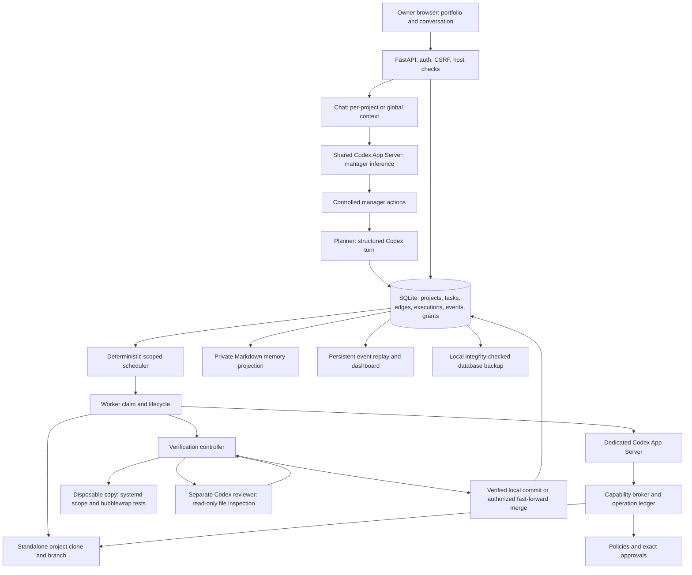
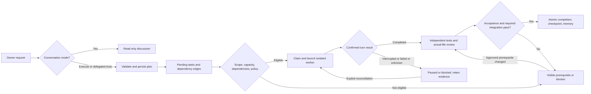
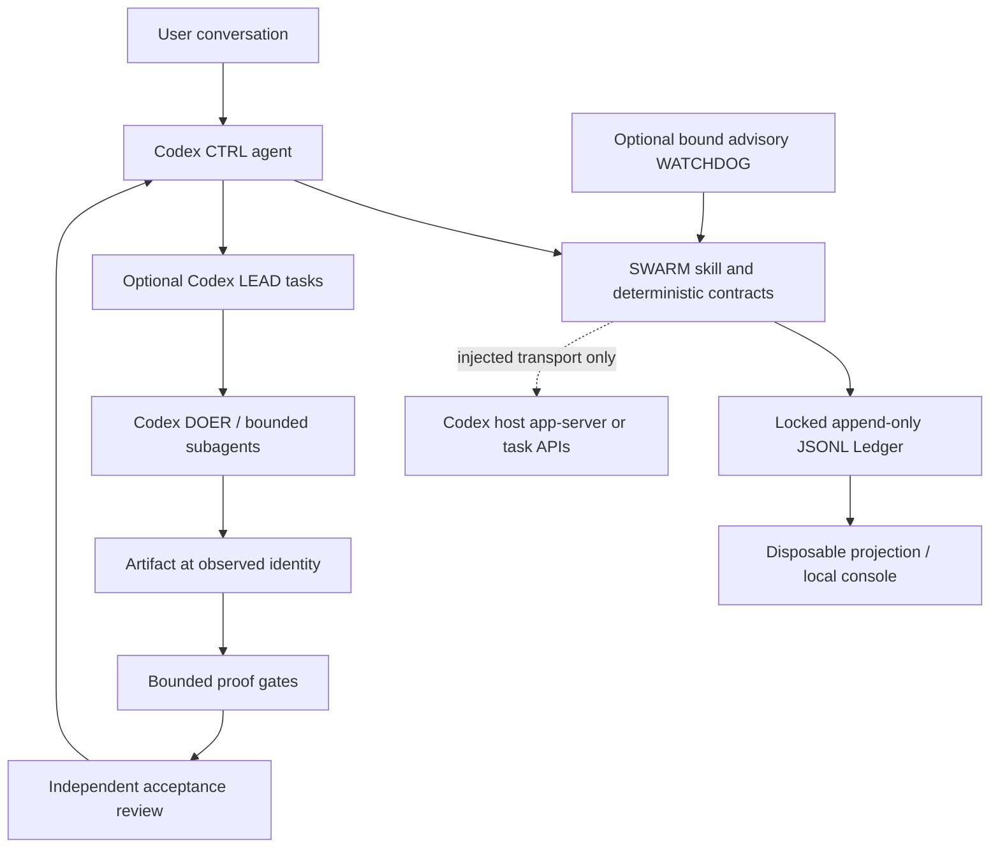
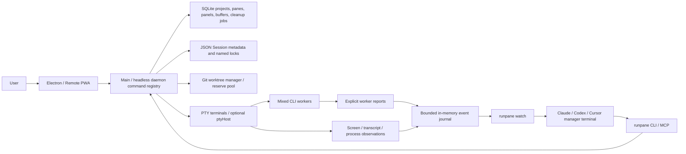
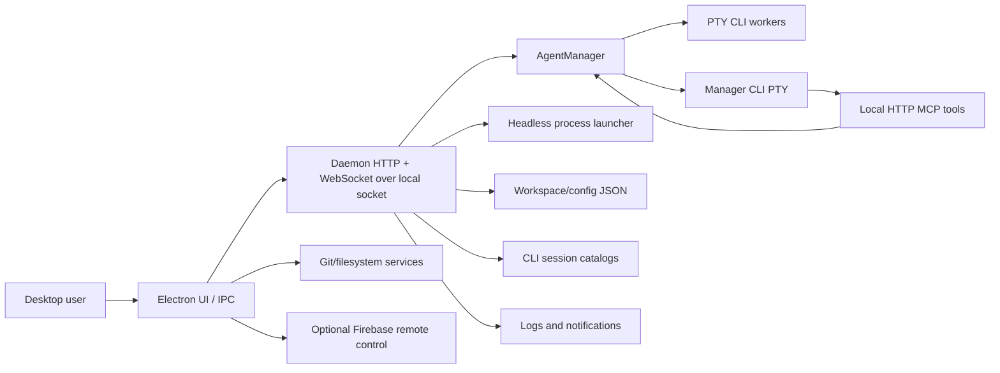
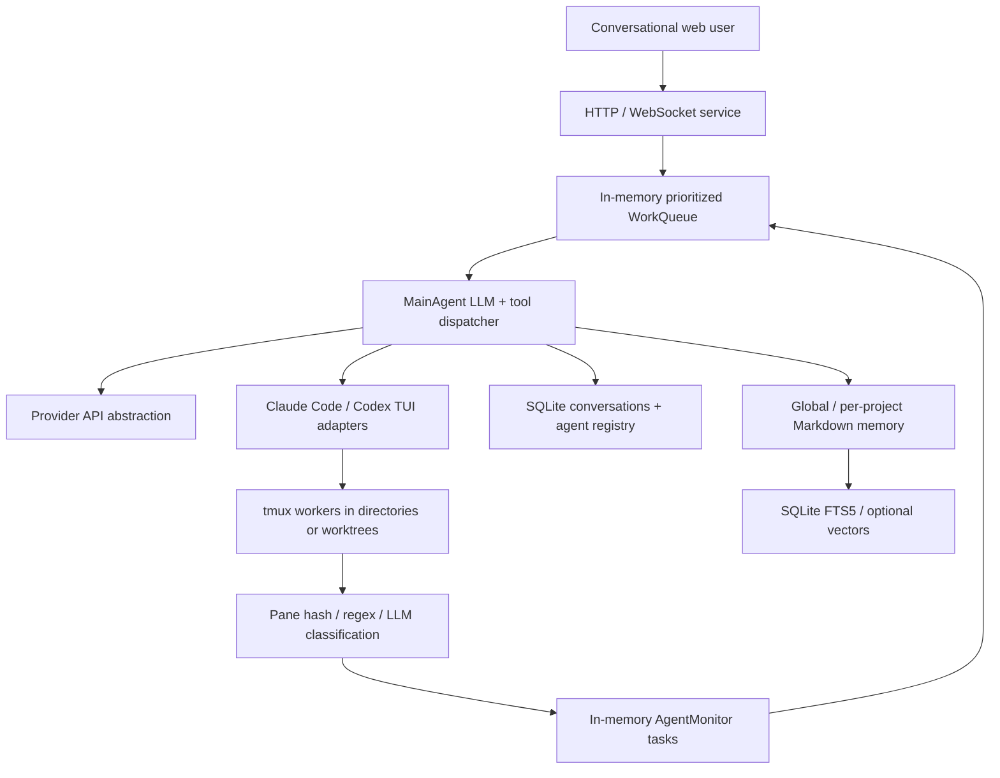
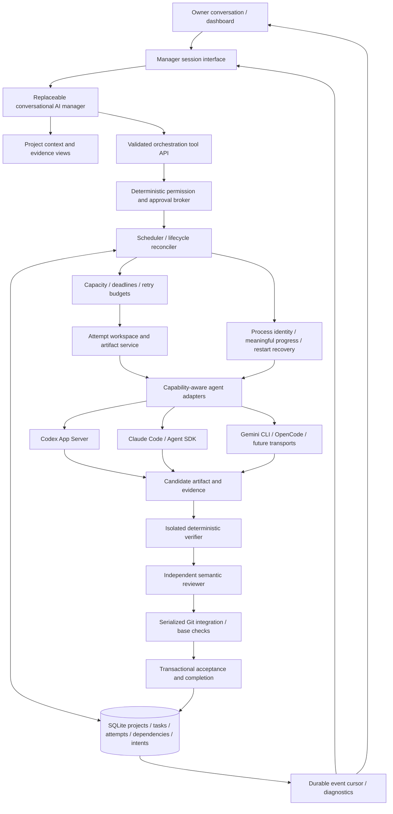
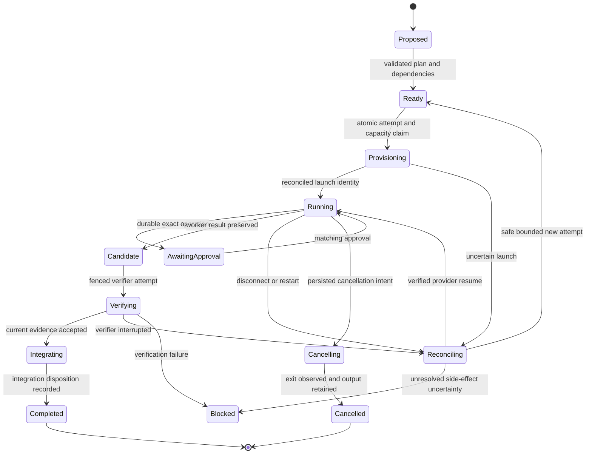

# AI Agent Orchestration Systems vs. Linko Bot Manager

Research date: **2026-10-10** (UTC; workspace timezone Asia/Tbilisi). Scope: the inspected source revisions, public evidence available on that date, and isolated Linko regression checks. This is a research report, not an implementation or deployment.

## 1. Executive summary

**Recommend Strategy D: retain Linko's deterministic foundation, repair confirmed lifecycle defects, and selectively refactor it into a provider-independent orchestration core. Borrow patterns rather than replacing the application or combining several complete runtimes.**

Linko already implements the most important distinction in the owner's goal: it manages durable tasks and acceptance, rather than merely opening terminals. Its existing SQLite transactions, project identities, dependency gating, brokered capabilities, exact approvals, isolated clones, reusable verification commands, independent review, and completion receipts are valuable. The portable suite passed **67 tests, with 15 host-runtime cases deselected**, against a disposable source snapshot in this investigation. That supports the tested behaviors, not a claim of universal reliability.

The largest functional gaps are provider dependence on Codex App Server, one active task per project, incomplete autonomous replanning/recovery, and project-specific verification provisioning. The most consequential confirmed defect is a verification claim that can survive a crash without its corresponding controller execution row, leaving work permanently stuck. Three narrower findings were reproduced: an advertised worker installation tool is not routed, runtime identities omit symlink targets and executable modes, and committed `.env.example` files prevent the verification snapshot. Additional source-confirmed lifecycle limitations and race windows are detailed below.

The external projects address different layers:

| System | Best fit | Main reason against replacing Linko with it |
| --- | --- | --- |
| SWARM | Explicit hierarchy, ownership, evidence, acceptance, and event-ledger contracts | Codex-only; important execution connectors are injected contracts, not a standalone autonomous supervisor |
| Pane | Broad CLI interoperability, replaceable conversational managers, terminal/worktree and remote UX | Persistent sessions are stronger than its deterministic task management; terminal readiness remains fallible; materially different security and licensing |
| Hydra | Desktop parallel Claude/Codex/OpenCode sessions with worktrees and a detached PTY daemon | No comparable durable task/DAG/acceptance engine; source-confirmed headless recovery gaps and failing head CI |
| superharness | Durable task lifecycle, claims, watcher/watchdog, adapters, and cross-agent handoffs | Closest orchestration foundation, but unsafe artifact cleanup paths and unresolved dispatch fixes prevent endorsing adoption as-is |
| omux | A separate conversational manager plus mixed workers, monitor loops, memory, and cross-vendor review | Durable conversations coexist with volatile tasks/monitoring; broad host authority; licensing clarity missing |

**There is no defensible overall “most reliable external system” winner.** superharness has the strongest durable orchestration mechanisms and public lifecycle stress evidence; Pane has the strongest visible distribution and user-feedback footprint. Neither demonstrates sustained unattended correctness across the owner's complete requirements. In particular, passing superharness CI does not eliminate its source-confirmed artifact-preservation problems. Linko's own narrow acceptance boundary is often stronger than these alternatives.

First three improvements: (1) atomically persist execution claims and repair recovery coverage; (2) make verification/runtime and capability contracts accurate and project-ready; (3) introduce capability-aware adapters for both manager and workers, preserving the current broker and verification boundary. No implementation was performed.

## 2. Research methodology and limitations

### 2.1 Repository identification and boundaries

The correct repository is `/home/codex/projects/Linko-Bot-Manager`, remote `git@github.com:Linkoge/Linko-Bot-Manager.git`, package `linko-bot-manager`. Its [master specification](../MASTER_SPEC.md) explicitly identifies that remote and the intended portfolio manager. `/home/codex/projects/AI-Manager` has a different remote, `cryptiama/AI-Manager`, and documents a Chatwoot customer-service deployment, not coding-agent orchestration. It was excluded after identification.

Linko baseline: **`e2079dccf3b935347b4b20fce30ab7cecfed7931`, branch `main`**. Initial `git status --short` was empty. All five requested external repositories existed and were cloned into `/tmp/linko-orchestration-research/`; no external source tree was copied into Linko. Initial sandbox clones failed DNS resolution; approved native read-only cloning succeeded. The cloud-environment runtime skill was read; its environment-status capability and network-policy file were unavailable, so no managed readiness assertion is made. Official OpenAI documentation was used for the Codex protocol assessment.

Source review traced Linko's backend modules, schema, configuration, frontend workflows, deployment/backup definitions, test fixtures, acceptance scripts, and relevant Git history. External reviews traced implementation paths, tests, configuration, licenses, workflows, release history, issues and PRs. No external installer, orchestration runtime, or external test suite was executed. Local Linko smoke scripts that start real inference, service operations, or browser runtimes were inspected but not run.

### 2.2 Evidence notation

| Marker | Meaning | What it does not establish |
| --- | --- | --- |
| **S** | Source implementation inspected at the recorded SHA | Correctness in every environment or successful live execution |
| **T** | Reproduced isolated test/probe in this investigation | Real model quality, broad project coverage, or a long-running production SLA |
| **R** | Repository test definition inspected, not run in this investigation | A passing local or live-provider test |
| **C** | Public CI result for the identified revision/run | End-to-end live model behavior or safe artifact preservation unless explicitly tested |
| **D** | First-party documentation, historical acceptance record, or release claim | Independently reproduced current deployment behavior |
| **U** | Public user/issue report; author relationship identified where possible | A confirmed current source defect without version and source correlation |
| **I** | Architectural inference or recommendation from evidence | An implemented feature |
| **?** | Not established in inspected evidence | Proof of absence across every branch, installation, or private deployment |

“Implemented and verified” below refers to the specific fixture-tested boundary. “Implemented but not verified” means source exists, but this investigation did not exercise that behavior. “Partially implemented” means a material part of the requested capability is missing. “Broken” is reserved for a demonstrated path or source-confirmed failure mechanism. “Planned but not implemented” and “Unclear” are used where appropriate. Numerical reliability scores are deliberately avoided.

### 2.3 Reproducible checks and limits

All 69 tracked Linko files were copied to `/tmp/linko-orchestration-research/linko-test-copy`, and original SHA-256 hashes recorded before testing. Existing installed dependencies were used read-only. The command below ran in that disposable directory with temporary fixtures and cache, using the repository's existing Python interpreter:

```bash
PYTHONDONTWRITEBYTECODE=1 /home/codex/projects/Linko-Bot-Manager/.venv/bin/python \
  -m pytest -q -m 'not host_runtime' \
  -o cache_dir=/tmp/linko-orchestration-research/pytest-cache-native \
  --basetemp=/tmp/linko-orchestration-research/pytest-native
```

Result: **67 passed, 15 deselected, one Starlette/httpx deprecation warning, 13.45 seconds**. Ruff on `ai_manager scripts tests` and `node --check ai_manager/static/app.js` passed. A restricted-runner attempt stalled and was interrupted; the bounded native rerun passed. Research-created diagnostic probes similarly required the native runner. These runner limitations are not classified as application defects.

The 15 excluded cases require the owner-supervised outer systemd/bubblewrap environment. The checked-in latest operational record reports **82 native tests and 67 isolated portable tests**, real Codex completion and restart preservation. That is **D**, not a new live test here. No production database, login, credential, approval queue, process, or service was changed or used to impersonate the owner. New probes used fake model transport and entirely disposable databases/repos.

Raw research material includes `manifest.json`, `linko-pytest.txt`, `linko-probes.py`, `linko-probes.json`, `linko-before-hashes.json`, external-source notes and GitHub API snapshots under `/tmp/linko-orchestration-research/`. `/tmp` is temporary; durable conclusions, code references and probe recipes are included in this report.

Public searches sought positive and negative experiences using exact owner/repository names plus issues, crash, reliability, reviews, Reddit, production, security, releases and CI. Similar project names, scraped directories, syndicated promotional material, and README mirrors were not treated as independent reliability measurements. No workload benchmark, failure probability, adoption count, or weeks-long unattended success rate was fabricated. API snapshots take precedence over stale cached GitHub HTML when state differs.

## 3. Linko Bot Manager architecture

### 3.1 Components and authority

Linko is a **centralized asynchronous Python service with a deterministic orchestration layer and AI reasoning roles**, not a distributed worker cluster. FastAPI provides authenticated HTTP APIs; plain browser JavaScript renders portfolio/tasks/agents/approvals/settings and reconnectable SSE output. A single process owns the data directory through an advisory `flock`; systemd can restart that process. SQLite is authoritative. Codex App Server supplies inference through JSON-RPC over subprocess stdio. [L1–L6]

| Component | Actual implementation and persistence | Deterministic or AI? |
| --- | --- | --- |
| Conversational manager | Per-project or global conversation; saved messages/thread IDs; Auto/Conversation/Execute modes; exact task/admin receipts appended to output | AI discussion and optional action selection; deterministic tool authorization and receipts |
| Project registry | Bounded discovery inside configured roots; stable IDs; objectives/instructions/priorities/status/revisions; source preserved | Deterministic |
| Memory | SQLite text for PROJECT/STATE/TASKS/DECISIONS/HANDOFF; atomic private Markdown projection; bounded context snippets and selected-document retrieval | Deterministic persistence; human/model text is data |
| Planner | New structured AI turn; 1–20 tasks; validation of priorities and earlier-index dependencies; atomic plan/tasks/edges; unique request key | AI decomposition; deterministic validation/application |
| Scheduler | Two-second loop; project/task priorities; dependency and policy readiness; one active task/project; global default two tasks; persistent scope/completion batch | Deterministic |
| Worker | Durable claim+execution, standalone shallow clone and branch; dedicated App Server; stored PID/start-time/thread/turn/model/usage/output | AI coding through restricted broker |
| Capability broker | Serialized per-worker file operations; path/hash validation; exact policy grants; started/completed operation ledger; restricted approved commands | Deterministic |
| Verifier | Registered tests in disposable copies; task-specific evidence checks; separate read-only AI review with actual inspected files; atomic completion/evidence/checkpoint | Deterministic gates plus AI acceptance reasoning |
| Integrator | Verified local commit and optional explicit-target fast-forward merge; source cleanliness/config checks; uncertain-operation reconciliation | Deterministic |
| Administration | Explicit project/action grants; stable request fingerprints; durable started/completed/failed receipts; workers excluded | Deterministic authority; manager can request scoped actions |
| Monitoring/recovery | Audit events, outputs, PID/start identity, leases, stream replay, scheduler state; no blind replay of uncertain effects | Deterministic, incomplete edge-case coverage |
| Hosting/backup | Private loopback service, documented Tailscale HTTPS; integrity-checked local SQLite backup and fresh-path restore | Deterministic; actual current hosting only documented here |

Important implementation distinctions:

- The field named `worktree` stores a **standalone clone**, not a Git linked worktree. Shared Git administrative storage is intentionally avoided. [L4]
- `project.agent_id` is a stable logical identity; it does not select a provider adapter. All manager/planner/worker/reviewer paths use Codex. [L3,L5]
- Worker code does not expose arbitrary shell, network, MCP connectors, built-in patching or autonomous subagents. Most coding is read/write/list/checkpoint plus registered tests and commits. Replacing this with an unrestricted CLI changes the trust model. [L5,L6]
- Project state is durable, but ongoing reasoning is not an always-on autonomous “CEO” loop. The scheduler dispatches existing plans and verifies outputs. New replanning after failures is mostly owner/manager-triggered; there is no general deterministic blocked-task escalation and replanning workflow. [L3]
- Durable messages and SQLite memory can survive weeks; actual resumability also needs the isolated workspace and Codex rollout storage. SQLite backup alone is insufficient. [L1,L11]

### 3.2 Existing architecture diagram



### 3.3 User request to completion

1. Authenticated `POST /api/chat` resolves the selected project and mode. `Chat.submit()` persists user/assistant messages and a manager execution; only one active response per conversation is permitted. Routes come from the actual Codex model catalog, which is not itself an entitlement test. [L5]
2. **Execute** invokes `plan_goal` deterministically using the message as the goal. **Auto** lets the conversational manager choose the action but appends actual task receipts, or says no executable task was created. **Conversation** rejects mutating management actions. [L5]
3. `Planner.plan()` produces JSON using `PLAN_SCHEMA`; `apply()` validates it and writes plan/tasks/dependencies in one transaction. A repeated persisted request key returns the same applied plan. This prevents replay of the same keyed request, not semantic duplication across new HTTP requests. [L3]
4. `Scheduler.tick()` starts verification for finished workers, then checks scheduling enablement, scope, batch and dependency readiness. `Workers.start()` atomically checks global/project capacity, claims the task and inserts the queued execution. Launch acknowledgment means **queued**, not that inference has started. [L3,L4]
5. `_run()` checks launch/branch policy, prepares an isolated committed baseline, starts App Server, records process/thread/turn, and exposes `manager_workspace`. The broker checks ownership, path, content hashes, policy epoch, reusable command identity and operation replay before effects. ASK waits on a 15-minute exact grant. [L4,L6]
6. A completed model turn moves the task to **verifying**, not **completed**. The controller runs approved tests in a disposable copy, checks deliverables and file integrity, and asks a separate model turn to review actual files. Review must cite files actually read through the broker. [L3,L7]
7. Required commit/merge is enforced before completion. Merge is local, fast-forward only, and needs an explicit authorized target branch plus unchanged clean baseline; no remote push follows. Completion, successful evidence, checkpoint and state text are recorded atomically, then memory exported. [L3,L8]
8. Lost transport, unexpected termination and uncertain operations block for reconciliation. Safe pre-thread launch retry, saved-thread resume and retrying only verification are separate operations. Approvals are invalidated on restart. [L4,L6]



## 4. Current implementation status

| Subsystem | Classification | Evidence and practical boundary |
| --- | --- | --- |
| Registry and independent projects | Implemented and verified | S/T: roots, discovery, revision protection, rename and source preservation; `test_foundation`, `test_web` |
| Persistent task queue and dependencies | Implemented and verified | S/T: SQLite task rows, transactional claims, earlier-index plan DAG, dependency gating; no broker/Redis required |
| Natural conversation and task delegation | Implemented and verified for fixtures | S/T: persistent messages, modes, explicit Execute and receipts; real model behavior D from latest acceptance record |
| Conversational long-term context | Partially implemented | S/T: thread IDs, bounded memory, history and tool-schema rollover; no provider-neutral semantic retrieval or broad autonomous learning |
| Parallel workers | Partially implemented | S/T: two concurrent projects/default cap; **same-project tasks serialize** even when their files are independent |
| Worker launch/resume/interrupt | Implemented and verified for tested paths | S/T: dedicated processes, queued vs started receipts, fake process kill test; no real provider turn started here |
| Worker installation tool | Broken on exposed worker route | S/T: schema/instructions advertise `install`; dispatch handler rejects it; controller/runtime provisioning exists separately |
| Generic provider/manager adapters | Planned but not implemented against this new goal | S: all roles instantiate/use Codex App Server; no Claude/Gemini/OpenCode adapter |
| Health/stall detection | Partially implemented | S/T: 20s local lease renewal, 300s notification inactivity and transport-loss handling; no absolute work deadline or independent meaningful-progress watchdog |
| Crash recovery | Partially implemented | S/T: uncertain effects block rather than replay; confirmed orphan verification claim is missed |
| Permission and approval system | Implemented and verified | S/T: exact hash/epoch/expiry/ownership, profiles, revocation and scoped administration; supported capabilities only |
| Workspace isolation | Implemented and verified for clones | S/T: standalone clones and bounded paths; Linux test sandbox code S, host-runtime checks excluded here |
| Independent code review | Implemented but live reasoning not reverified | S/T for protocol/gates; separate Codex reviewer and actual-read requirement; same-provider cognitive correlation remains |
| Tests and acceptance | Partially implemented | S/T: approved argv, config identity, deterministic evidence and review; tracked sensitive-path compatibility and artifact identity gaps |
| Offline runtime/dependencies | Partially implemented | S/T: approved project artifact copying and controller provisioning; worker `install` route missing; arbitrary online install unavailable |
| Local commit/merge | Implemented but OS/Git integration acceptance not rerun here | S: verified commit, optional explicit-target ff-only merge, preservation/reconciliation guards; related host cases excluded |
| Remote push/deployment/host administration | Planned but not implemented | S: policy labels exist; unsupported actions fail closed; no executor/credentials implied |
| Monitoring and logs | Implemented and verified for fixtures | S/T: durable events, SSE cursors, task receipts, dashboard; no service-level metrics/alerts or retention budget |
| Resource limits | Partially implemented | S: command wall/output/CPU/memory/process/disk budgets; AI-turn/global provider quotas and artifact retention incomplete |
| Backup and restore | Implemented and verified for database fixtures | S/T: SQLite backup integrity/FK checks and fresh-path restore; workspaces/rollouts/off-VM recovery are separate |
| Full VM reboot and extended unattended use | Unclear in this investigation | D: historical restart and changed boot evidence; no newly observed coordinated reboot or soak test |
| Owner chat administration | Implemented and verified for fixtures | S/T: grants, active manager identity, fingerprints and durable receipts; real chat administrative turn D |

**Documentation chronology matters.** [README](../README.md), [PROJECT](../PROJECT.md), and older sections of [verification](verification.md) still say dependency installation/merge are unavailable and storage is nearly full. Current source and the latest section of [autonomy upgrade](autonomy-upgrade.md) supersede those statements: offline runtime provisioning and verified local integration are implemented; latest recorded storage was roughly 170GiB free, and the owner-approved manager verification blocker was resolved. Other projects still need their own commands/runtime. This report does not repeat obsolete all-project blockers as current defects, or turn historical deployment claims into fresh observations.

## 5. Confirmed defects and reliability risks

### 5.1 Confirmed findings

#### F1 — Orphan verification lease can strand a task after restart (high priority; S/T)

[Primary source: ai_manager/orchestration.py:401](https://github.com/Linkoge/Linko-Bot-Manager/blob/e2079dccf3b935347b4b20fce30ab7cecfed7931/ai_manager/orchestration.py#L401).

`ai_manager/orchestration.py:401–413` uses two independent transactions: the first commits `tasks.lease_owner`/`lease_until`; the second inserts the `verification-controller` execution. A crash between them leaves `status='verifying'` and a nonnull lease with no controller row. `workers.py:512–535` recovers only executions; `workers.py:537–541` sweeps only running/awaiting-approval tasks; `orchestration.py:798–802` schedules verification only when lease_owner is NULL. `Tasks.recover_expired()` exists at `tasks.py:146–160` but has no production caller in the inspected source.

The disposable probe persisted exactly that inter-transaction state, ran worker/scheduler recovery, stale detection and a scheduler tick, and observed **verifying, lease_owner=missing-controller, controller_exists=false, scheduled_reviews=0**. This reproduces the recovery behavior, not a claim that a production crash already hit that window. Existing public task controls refuse changes to verifying tasks, and retry requires blocked state, making operator recovery difficult.

Recommended future repair: claim+execution in one transaction; a sweeper covering every leased operational state; deterministic orphan-claim reconciliation into a visible blocked state; a fault-injection test at each commit boundary. Preserve unknown filesystem effects rather than automatically repeating them.

#### F2 — Worker `install` capability is advertised but never dispatched (medium/high functional priority; S/T)

[Primary source: ai_manager/workers.py:309](https://github.com/Linkoge/Linko-Bot-Manager/blob/e2079dccf3b935347b4b20fce30ab7cecfed7931/ai_manager/workers.py#L309).

`workers.py:24–60` exposes operation `install` and worker instructions mention approved dependency command IDs; `capabilities.py:47,65–73,121–146` implements the operation. But the worker handler at `workers.py:309–324` forwards only list/read/write/test/commit/delete, special-cases checkpoint, and rejects everything else. A fake worker called the exposed tool with `operation='install'` and received **“Capability is not enabled”** before any command execution. This is a route mismatch, not absence of all dependency support: offline runtime and verifier provisioning paths do exist.

Future repair should reconcile advertised capability descriptors with handler coverage and approval behavior. Do not “fix” it by adding arbitrary shell or unapproved online installers.

#### F3 — Runtime tree identity does not bind symlink targets or executable modes (medium; S/T)

[Primary source: ai_manager/verification_runtime.py:11](https://github.com/Linkoge/Linko-Bot-Manager/blob/e2079dccf3b935347b4b20fce30ab7cecfed7931/ai_manager/verification_runtime.py#L11).

`verification_runtime.py:11–20` checks that symlinks resolve inside the artifact but excludes them from the hash map; it hashes regular file bytes only. The probe put regular files `a` and `b` in a package, changed the package's `python` symlink from `a` to `b`, and changed a file's executable mode. The identity remained unchanged in both cases. `provision():35–36,58` therefore cannot distinguish these materially different packages through its stored identity.

Impact: reproducibility and integrity claims are weaker than “immutable package” suggests. This is **not evidence of a credential escape or active exploitation**; escaping symlinks are still rejected. Future identity should include canonical relative paths, entry type, relative link target, executable bits and file bytes, with explicit safe-link rules.

#### F4 — Committed `.env.example` blocks the all-input verification digest (medium portability; S/T)

[Primary source: ai_manager/verification_strategies.py:54](https://github.com/Linkoge/Linko-Bot-Manager/blob/e2079dccf3b935347b4b20fce30ab7cecfed7931/ai_manager/verification_strategies.py#L54).

`workspace.py:13–32` intentionally rejects `.env` and every `.env.*` path. `verification_strategies.py:54–58` applies that access policy to **every tracked file** while creating the content snapshot, regardless of whether the model needs to read it. The disposable fixture staged a harmless `.env.example` containing a placeholder and `content_digest()` raised **“Path is outside the permitted project content”**. Existing tracked symlinks/prohibited directories can similarly constrain compatibility (S; not all combinations reproduced).

Impact: common repositories can run approved commands yet fail the mandatory integrity gate. Do not relax secret disclosure. Separate opaque integrity metadata from model-visible file access, classify example files deliberately, and define how unsupported paths affect an acceptance profile.

#### F5 — Scheduler batch accounting is not atomic with dispatch (source-confirmed crash window; S, not reproduced)

[Primary source: ai_manager/orchestration.py:835](https://github.com/Linkoge/Linko-Bot-Manager/blob/e2079dccf3b935347b4b20fce30ab7cecfed7931/ai_manager/orchestration.py#L835).

`orchestration.py:835–839` commits worker dispatch through `Workers.start()` and only afterwards writes the task into `scheduler_batch.task_ids`. A crash before the second write preserves a real execution that is absent from the completion-budget ledger. Budget calculations at `:808–833` consult only those recorded IDs. A recovered/manual-resumed task can finish without counting toward the intended batch, permitting extra completions. `web.py:419–423` also stores scope, batch, enablement and capacity in separate transactions; readers can observe mixed configuration.

This does not prove duplicated worker claims: those are transactionally guarded. It demonstrates a weaker **batch boundary**, important when an owner authorizes a bounded unattended run. Future dispatch reservation, batch membership and execution creation should share one transaction; settings changes should be atomic snapshots.

#### F6 — Active verification has no supported interruption route in the UI/API (source-confirmed capability gap; S)

[Primary source: ai_manager/web.py:615](https://github.com/Linkoge/Linko-Bot-Manager/blob/e2079dccf3b935347b4b20fce30ab7cecfed7931/ai_manager/web.py#L615).

`web.py:615–621` sends every task-associated execution to `Workers.interrupt()`. Verification-controller executions have no worker server/job entry, and the model reviewer created by `structured_turn()` has no task_id and is consequently routed to `Chat.interrupt()`, which accepts only manager executions (`chat.py:389–398`). Generic task control also rejects verifying states (`web.py:523–528`). Scheduler owns review jobs in memory (`orchestration.py:730,798–802,950–956`) but exposes no task-level cancel/interruption operation for them.

Result: the dashboard's generic Interrupt control cannot cancel these execution roles as its label implies; verification waits for its internal command/notification limits or service shutdown. This is a UX/lifecycle limitation, not a claim of a proven deadlock. Future unified execution supervision should dispatch cancellation by execution kind and preserve uncertain outcomes.

### 5.2 Risks and design limitations, not confirmed incidents

| Risk | Supporting source | Technical implication and confidence |
| --- | --- | --- |
| Lease heartbeat measures manager activity, not meaningful agent progress | `workers.py:402–408,468–471,537–544`; `orchestration.py:416–419` | Active jobs bypass stale detection; any continuing notifications renew the inactivity window indefinitely. No absolute task-turn budget or progress watchdog was found. S/I; no runaway production turn observed |
| Heartbeat failures are not supervised while execution continues | `workers.py:250,453–456,468–471` | A background heartbeat exception is observed only during final gather; DB stalls/lease loss need a deterministic execution stop path. S/I |
| AI-role concurrency is not a complete resource budget | `chat.py:97–136`; `orchestration.py:122–209,286–307`; `config.py:19` | Worker task count is capped; concurrent per-project chats and direct planning requests are not covered by that cap. Extra App Servers, provider limits and output cost remain possible. S/I |
| Heavy synchronous DB/Git/file work in async paths | `db.py:118–137`; `chat.py:284–298`; `registry.py:21–36`; `verification_strategies.py:54–58` | FULL SQLite commits per delta, whole output updates, synchronous Git and hashing can stall the event loop. No latency benchmark was run. S/I |
| Projection I/O holds SQLite writer lock | `registry.py:172–181` | Large/slow memory exports increase contention; task state is authoritative but filesystem projection should have bounded failure semantics. S/I |
| No durable launch acknowledgment handshake beyond local records | `workers.py:268–298,337–385` | A crash after process/thread/turn creation but before IDs are recorded leaves uncertainty. Recovery blocks instead of replaying, which is safe but not highly autonomous. S/I |
| Retry policy is mostly “block and reconcile” | `workers.py:203–242`; `capabilities.py:98–107` | Avoids repeated non-idempotent effects, but there is no complete taxonomy/backoff/bounded auto-retry for clearly safe transport/preparation failures. S |
| Per-project parallelism absent | `workers.py:152–156`; `tasks.py:129` | Prevents conflicting manager workers simply but limits a single large project; raising global max alone cannot change it. S/T |
| Source integration can race external editors | `integration.py:167–172,201–211` | Clean/head checks and ff-only prevent many conflicts, but no persistent lock coordinated with other tools spans check to checkout/merge. Git locks narrow Git races, not all concurrent file writes. S/I, no destructive reproduction |
| Artifacts and backups accumulate | `verification_workspace.py:28–40`; `scripts/backup_daily.py`; `workspace.py:44–91` | No automatic retention or recovery-aware garbage collection found; space checks fail closed but do not create capacity. S/I |
| Trusted backend shares the host owner's authority | `codex.py:73–80`; deployment service template; `docs/security.md` | Broker/command isolation does not contain compromise of Python/App Server itself. Credential filenames are a filter, not a secret scanner. Documented design boundary, not a discovered credential leak |
| New-chat semantic duplicates remain possible | `chat.py:104–132`; `Planner.apply():246–248` | Stable keyed plan replay is safe; a resent message with a new execution/call ID is a different key. Deterministic goal-intake idempotency should be exposed to clients. S/I |
| Review is independent in session, not necessarily in model family | `orchestration.py:521–550`; `codex.py:189–197` | Same-provider correlated errors; actual-file inspection and tests are meaningful but acceptance still has AI reasoning uncertainty. S/I |
| Research evidence is not externally fetched during verification | `verification_strategies.py:96–100,120`; App Server web search disabled | URLs and limitations are required, but claim/source correspondence is assessed from available file content, not online validation. Known capability boundary; no fabricated-source incident alleged |

### 5.3 What this audit did not confirm

No evidence justifies saying Linko currently loses all tasks, duplicates transactional claims, lets agents bypass approval through prompts, force-merges dirty work, exposes credentials to test processes, or marks every model completion successful. The code and fixture checks substantiate protections against several of those problems. Historical missing-command, repeated-resume and offscreen-error defects have documented fixes; the latest manager runtime setup supersedes older blockers. There is no basis for declaring the whole architecture broken or recommending a rewrite solely because it is young.

## 6. SWARM investigation

### 6.1 Actual architecture

The canonical tree is `skills/swarm`; `plugins/swarm` is a generated marketplace mirror. There are Python runtime contracts, scripts, Codex instructions/role references, hooks, proof and progress event stores, and a local console. The manager is an **LLM executing in the Codex host**, guided by the skill and bounded by deterministic contracts where those contracts are called. CTRL owns one objective; optional LEADs own durable outcome lanes; DOERs own artifacts; review is separate from production. Native Codex host tasks and bounded subagents supply execution. Python code models allowable operations, acceptance, retry policy and event projections. This is hierarchical and event-oriented, but its execution authority resides in the host.

The README deliberately states the universal HQ connector does not start a process and that console wiring/live availability are not established by the source contract. Treat this caveat as an architectural boundary, not an omitted feature inferred solely from a search. [Pinned README](https://github.com/flowwweb/swarm/blob/51c9f40ef5d680f17a4c830ec335b8b95c08cc03/README.md).



Important source owners:

- `runtime/core.py`: typed topology, task/worker state, ownership, graph selection, acceptance, dependency waits, proof execution, retry decisions. The central `Swarm` dataclass carries in-memory workers/tasks/leases and many receipt registries (`core.py:1961`). Do not imply every field is an independently durable process manager state.
- `runtime/topology.py`: graph and dispatch contracts. `core.py:1318–1336` rejects multiple CTRL roots, unknown dependencies and cycles and identifies parallel graph choices. This is deterministic contract validation; graph execution still needs host APIs.
- `runtime/progress_events.py:2487`: canonical material event authority and replayable projection. Its append path validates schema/digest/deduplication and retains event order under an OS lock.
- `runtime/request_ledger.py:36`: request transport inbox and acknowledgement journal, explicitly **not lifecycle authority**. The separation prevents a transport acknowledgement being treated as task completion.
- `runtime/execution_adapters.py`: capability matrices, reservation/reconciliation contracts and Codex app-server request construction. A protocol boundary exists; an out-of-process provider-independent worker supervisor does not.
- `runtime/automation.py`: typed authority, checkpoint, fetch, review and integration/release decisions; it emits allowed/blocked decisions rather than performing all external operations itself.
- `runtime/health.py`: advisory requests to active CTRL, not automatic replacement or process restart.

### 6.2 Manager capability and practical autonomy

Planning, decomposition, routing, ownership and conversational decisions use AI reasoning. State validation, permission receipts, exact identity checks, proof planning and event acceptance use deterministic code. The workflow can support one conversational CTRL coordinating parallel Codex lanes where its host exposes tasks/goals/tools. Persistent root/project ledgers and goals are designed to preserve context and ownership. However, there is no demonstrated service-level guarantee that a primary manager resumes automatically after days, schedules unattended work, or supervises disconnected OS processes independently of the host.

SWARM favors a small justified graph, requires named accountability, and insists that activity/dispatch/silence is not evidence of completion. These are valuable ideas for Linko: clear producer ownership, separate review authority, and truthful operational statuses. It also has a potentially substantial overhead cost: receipt types, manifests, authority registries, instruction bundles, mirrors and console views add complexity. Adopting the entire policy framework would couple Linko to Codex host assumptions and likely exceed what is necessary for a durable SQLite scheduler.

### 6.3 Agent independence

**Only Codex is supported as a host.** README explicitly excludes claimed compatibility with Claude Code, Anthropic, Gemini, Copilot, Cursor, OpenCode and other hosts. Generic names such as `provider` refer in some places to external payment/auth/deployment proof, not to model-agent independence.

The app-server adapter constructor accepts an injected `CodexAppServerTransport` and has an empty entrypoint (`execution_adapters.py:1335–1361`). `plan_hq` returns disabled when no transport exists (`1363–1372`). Required topology dispatch is marked **instruction-only**, review acceptance and host task mutation unsupported (`1354–1357`). It can produce real `thread/start`, `thread/resume`, `turn/start`, steering and related wire calls through a host-supplied transport, but **the inspected repository does not itself establish live standalone integration**. [Adapter source](https://github.com/flowwweb/swarm/blob/51c9f40ef5d680f17a4c830ec335b8b95c08cc03/skills/swarm/runtime/execution_adapters.py#L1335).

There are abstract request contracts and a test named `test_provider_neutral_adapter_uses_the_same_request_contract`, but that test is not a Claude/Gemini/OpenCode adapter. Adding an actual agent provider requires execution capability, authorization, lifecycle and host semantics, not merely subclassing an abstract adapter. Codex-manager/Claude-worker and the inverse are therefore **unsupported**, rather than assumed from generic adapter vocabulary. No Cowork integration was found.

### 6.4 Persistence, retries and reliability

**Concrete strengths (S/T):**

- OS-level exclusive locks use `fcntl.flock` on POSIX and `msvcrt.locking` on Windows; private state writes use same-directory temporary file, flush, `fsync`, `os.replace` and restrictive file mode. [private_state.py:19–41](https://github.com/flowwweb/swarm/blob/51c9f40ef5d680f17a4c830ec335b8b95c08cc03/skills/swarm/runtime/private_state.py#L19).
- RequestStore changes validate the whole candidate snapshot and use sequence plus digest for stale-write rejection; unchanged mutation returns unchanged state. [request_ledger.py:103–125](https://github.com/flowwweb/swarm/blob/51c9f40ef5d680f17a4c830ec335b8b95c08cc03/skills/swarm/runtime/request_ledger.py#L103).
- Canonical JSONL material events are checked for event identity and semantic deduplication before append; accepted lines are flushed and fsynced. The projection is disposable and replayed from the journal. [progress_events.py:3475–3515](https://github.com/flowwweb/swarm/blob/51c9f40ef5d680f17a4c830ec335b8b95c08cc03/skills/swarm/runtime/progress_events.py#L3475).
- Connector reservation rejects conflicts and wrong expected revision, reconciles exact replay, and records idempotency identity before host dispatch. Local reservation semantics are stronger than a blind resend; they do not prove exactly-once external execution. [progress_events.py:3444–3473](https://github.com/flowwweb/swarm/blob/51c9f40ef5d680f17a4c830ec335b8b95c08cc03/skills/swarm/runtime/progress_events.py#L3444).
- Execution reservation permits only one bounded retry and distinguishes timeout/bad-request/missing evidence. [execution_adapters.py:947–994](https://github.com/flowwweb/swarm/blob/51c9f40ef5d680f17a4c830ec335b8b95c08cc03/skills/swarm/runtime/execution_adapters.py#L947).
- Proof gates execute argv with `shell=False`, timeout, process group/Windows-job cleanup of descendants, and a maximum of two attempts only for typed transient infrastructure failures. [core.py:686–725](https://github.com/flowwweb/swarm/blob/51c9f40ef5d680f17a4c830ec335b8b95c08cc03/skills/swarm/runtime/core.py#L686), [core.py:3123–3167](https://github.com/flowwweb/swarm/blob/51c9f40ef5d680f17a4c830ec335b8b95c08cc03/skills/swarm/runtime/core.py#L3123).
- Gate proof binds artifact identity, plan, argv, environment and before/after observables. Passing process return code is rejected as valid proof if the artifact changed. Independent exact-artifact review, integration and architecture gates are required by `complete`; dependent waiters are released only afterward. [core.py:3303–3320](https://github.com/flowwweb/swarm/blob/51c9f40ef5d680f17a4c830ec335b8b95c08cc03/skills/swarm/runtime/core.py#L3303).
- Tests inspect duplicate/stale/conflicting requests, write failure rollback, counterfeit receipts, admission, adapter replay, ambiguous host identities, timeout/silence and completion claims. [test_execution_adapters.py](https://github.com/flowwweb/swarm/blob/51c9f40ef5d680f17a4c830ec335b8b95c08cc03/skills/swarm/tests/test_execution_adapters.py), [test_request_ledger.py](https://github.com/flowwweb/swarm/blob/51c9f40ef5d680f17a4c830ec335b8b95c08cc03/skills/swarm/tests/test_request_ledger.py). Some test files are text-contract checks rather than runtime behavior tests; count/size alone should not be treated as proof.

**Confirmed limitations and qualified risks:**

1. **Monitoring is not autonomous supervision.** `HealthRecoveryRequest` says it cannot create tasks or mutate host state; payload says active CTRL must use normal host APIs (`health.py:38–39,91`). Documentation explicitly states a bound watchdog never recovers, releases, reassigns, polls or becomes a daemon. This prevents claiming crash recovery from the presence of a `health.py` file. [health.py](https://github.com/flowwweb/swarm/blob/51c9f40ef5d680f17a4c830ec335b8b95c08cc03/skills/swarm/runtime/health.py#L38).
2. **A malformed/torn journal tail fails closed instead of automatically recovering the valid prefix.** Replay reads all bytes and raises on malformed JSON or noncontiguous sequence (`progress_events.py:3226–3241`). This is confirmed behavior. Whether a particular OS crash produces such a tail was not tested. The availability risk under disk-full/partial append/crash is a reason to prefer SQLite transactions or explicitly designed tail repair in Linko. Do not label fail-closed corruption handling itself an integrity defect. [replay source](https://github.com/flowwweb/swarm/blob/51c9f40ef5d680f17a4c830ec335b8b95c08cc03/skills/swarm/runtime/progress_events.py#L3226).
3. **Full replay under a single lock scales with accumulated history.** Append reconstructs the entire projection from all records. Source establishes this cost path; no benchmark quantifies its practical limit. A cached compact projection exists for views, but append uses authoritative replay. This is an operational scaling inference, not measured performance failure.
4. PrivateState's temporary snapshot fsync does not fsync the parent directory after rename. This leaves power-loss durability dependent on filesystem guarantees; no actual lost state was observed.
5. Leases and role checks model coordination but are not OS sandbox/credential isolation. Native host worktrees/permissions supply underlying enforcement. A skill cannot guarantee exclusive files merely by instructing agent owners.

### 6.5 Security, operations and project management

Positive boundaries include host-owned authorization, digest/root/revision/expiry-bound command envelopes, no silent alternate route when capabilities are unavailable, explicit user authority for replacing CTRL, privacy-aware diagnostics, loopback-only console claims and bounded proof execution. Source denies unsupported external proof until a verifier records it (`core.py:3168–3170`). The console and local state still access Codex metadata and write settings; [SECURITY.md](https://github.com/flowwweb/swarm/blob/51c9f40ef5d680f17a4c830ec335b8b95c08cc03/SECURITY.md) identifies local path handling, loopback, request auth, configuration and Docker mounts as security surfaces. No sandbox separating workers' home directories or secrets was established.

Python 3.11+ is required; standard library runtime is relatively portable. Docker console is optional, Codex plugin host is required for intended use. Headless proof/ledger operations are possible but are not a headless autonomous orchestration service. Multiple projects can have own root-bound ledgers and console projections, yet cross-project global queues/resource control remain host/workflow responsibilities. Persistent task context exists as goal/ledger/Hive records; long unattended resume depends on host support and working ownership receipts.

### 6.6 Public evidence and maturity

API snapshot: created 2026-08-09; 4 stars, 0 forks; last push 2026-10-05 UTC. One open issue count includes PRs. The fetched recent issue API page contained no actual user issue bodies, only PR records; the browser issue page displayed no results and restricted issue creation. Searches using exact repository identity, bugs/reliability, reviews and Reddit did not find credible independent runtime reports or measured autonomous reliability. Do not generalize this to “no one uses SWARM.” It establishes weak public validation and a constrained reporting surface.

The inspected SHA has a successful [CI run on 2026-10-05](https://github.com/flowwweb/swarm/actions/runs/37354417654), successful [scheduled run on 2026-10-09](https://github.com/flowwweb/swarm/actions/runs/37984270038), and an earlier [failed CI run on 2026-10-05](https://github.com/flowwweb/swarm/actions/runs/37351015733) followed by success in the same PR sequence. This is real maintenance/check evidence, not a deployment benchmark. The API's three latest tagged releases were August 18 releases, while main moved through October, so pinning main and pinning a published version may yield materially different systems. [Releases](https://github.com/flowwweb/swarm/releases), [PR #21](https://github.com/flowwweb/swarm/pull/21).

**Assessment:** strongest among these two for proof/acceptance discipline and explicit authority boundaries; unsuitable as a provider-neutral standalone Linko replacement; unattended reliability not established.

## 7. Pane investigation

### 7.1 Actual architecture

Pane combines Electron desktop, React/Zustand renderer, sandboxed preload IPC, TypeScript deterministic services, SQLite projects/panes/panels/output, node-pty terminals (optionally Electron utility process), and a daemon reachable through local socket/named pipe or authenticated HTTP/SSE. `runpane` CLI and MCP bridge operate the same command registry. Remote PWA/mobile clients control a self-hosted host over Tailscale. An optional global Pane Chat and named Sessions launch a normal coding agent as manager, equipped with generated instructions and orchestration skills. [Architecture index](https://github.com/greenfield-inc/Pane/blob/d760dbb80a60ebd42c0b4dc731ad3fb0bad3b6d5/docs/ARCHITECTURE.md).

Terminology matters: a stored base repository is a Project; a Pane is a feature workspace/worktree; a Panel is a terminal/diff/file/etc tab; a named orchestration Session is manager workspace metadata across Panes. Ordinary worktree session rows in `sessions.db` are not a transactional task queue.



This is centralized deterministic lifecycle infrastructure plus AI-managed workflow, event-driven monitoring and flexible parallel PTYs. It is materially more than a raw terminal multiplexer, but the planning/scheduling/review loop remains an instruction-following manager agent.

### 7.2 AI manager and project capabilities

`PaneChatManager` locks singleton creation and selects manager from Claude, Codex or Cursor (`paneChatManager.ts:29–53`). It owns a detached workspace under the data directory, separate agent panels and session IDs. Claude gets a persisted UUID; Codex/Cursor reuse native IDs observed from their output (`196–205`). [Manager source](https://github.com/greenfield-inc/Pane/blob/d760dbb80a60ebd42c0b4dc731ad3fb0bad3b6d5/main/src/services/paneChatManager.ts#L29).

Named `OrchestrationSessionManager` adds goals, context, decisions, blockers, next action, evidence/output links, pane associations and revision checks. Stored metadata is validated JSON, not SQLite. `orchestrationSessionStore.ts:72–105` defines the record; `135–150` writes a candidate via unique temp file and rename, publishing in-memory state only after success. Its whole-store ceiling is 2 MB. Manager update serializes changes and rejects wrong expected revision (`orchestrationSessionManager.ts:301–307`). [Session store](https://github.com/greenfield-inc/Pane/blob/d760dbb80a60ebd42c0b4dc731ad3fb0bad3b6d5/main/src/services/orchestrationSessionStore.ts#L72), [manager revision checks](https://github.com/greenfield-inc/Pane/blob/d760dbb80a60ebd42c0b4dc731ad3fb0bad3b6d5/main/src/services/orchestrationSessionManager.ts#L301).

Generated instructions describe fair rotation, resume failed workers from durable state, handing back structured reports, separate reviewers/QA, one feature/worktree/branch, and a daemon-owned watcher. `skillCacheManager.ts:530–565` contains dispatch/report/lock guidance; `644–735` defines liveness behavior. These are credible implemented **workflow instructions**, not deterministic scheduler guarantees. The `orchestrate-sessions` ledger reference explicitly falls back to AI-maintained `.agent/ledger.json` and stage/status files, including caps and queued/running/in-review/done stages. [Ledger reference](https://github.com/greenfield-inc/Pane/blob/d760dbb80a60ebd42c0b4dc731ad3fb0bad3b6d5/main/src/services/paneChatBundle/skills/orchestrate-sessions/references/ledger.md).

Persistent independent repositories/worktrees, conversation IDs, notes and Session metadata support resumption across days in principle. Actual transcript retention and CLI version support determine whether an agent conversation can be reopened; a durable Session row is not a saved model process. Independent project context is implemented, while global autonomous resource-aware task scheduling/dependency DAG completion is not established.

### 7.3 Agent compatibility and replaceability

Native terminal presets: Claude Code, Codex CLI, Cursor Agent, OpenCode. Manager choices: Claude, Codex, Cursor. OpenCode is **not yet a named Session/Pane Chat manager**. Other tools, including Gemini CLI, Aider and Goose, can run as arbitrary CLI commands; generic TUI handling is less precise and does not establish per-agent tested lifecycle integration.

New CLI agents do not need a manager subclass to launch. However, first-class readiness/resume/status means changing classifier, preset contract, launch resolver, agent-specific pure module, screen manifest, transcript/session-id logic, doctor checks and UI registration. The README's “zero integration” is accurate for running a terminal, not for verified semantic orchestration. [Adding new agents guide](https://github.com/greenfield-inc/Pane/blob/d760dbb80a60ebd42c0b4dc731ad3fb0bad3b6d5/docs/ADDING_NEW_CLI_TOOLS.md).

Agent status manifests explicitly map Claude/Codex/Cursor/OpenCode (`agentStatus/manifests.ts:462–465`) and include captured version fixtures and generic fallback. Wrapper executables are opaque unless correctly declared or discovered. Cross-provider manager/worker pairs, such as Codex manager and Claude worker or Claude manager and Codex worker, are structurally implemented through runpane and shared core; no live cross-provider end-to-end run was performed here. New providers can be added without replacing the whole core but **not without touching integration registration/core launch branches**.

Pane does launch **Codex app-server for usage/account telemetry**, not its normal coding-agent orchestration. `agentUsageService.ts:179–201` spawns `codex app-server --listen stdio://`; `371–379` reads `account/read` and `account/rateLimits/read`. This should be marked telemetry support, not app-server worker/control adapter support. [Usage service](https://github.com/greenfield-inc/Pane/blob/d760dbb80a60ebd42c0b4dc731ad3fb0bad3b6d5/main/src/services/agentUsageService.ts#L179). No Cowork integration exists in the inspected source; PTY compatibility with Claude Code does not cover a separate Cowork product.

### 7.4 Reliability strengths

- Projects, sessions, conversation messages, panel buffers and output exist in SQLite; WAL and synchronous NORMAL are configured (`database.ts:248–250`). Original schema identifies projects and pane/session identities (`schema.sql:1–51`). [SQLite schema](https://github.com/greenfield-inc/Pane/blob/d760dbb80a60ebd42c0b4dc731ad3fb0bad3b6d5/main/src/database/schema.sql#L1), [pragmas](https://github.com/greenfield-inc/Pane/blob/d760dbb80a60ebd42c0b4dc731ad3fb0bad3b6d5/main/src/database/database.ts#L248).
- **Strong concrete recovery pattern: durable archive cleanup intent.** SQLite `archive_cleanup_jobs` stores queued/running/failed/completed state and script/detach/purge/artifacts phases; no session FK avoids accidentally erasing deletion intent when history is deleted (`database/archiveCleanup.ts:19–42`). Archive requests commit archive flag plus cleanup job together (`database.ts:3506–3518`); cleanup supervisor resumes explicit intents, validates repository/path identity, captures process identity, serializes per-repo mutations and limits global concurrency. [Cleanup store](https://github.com/greenfield-inc/Pane/blob/d760dbb80a60ebd42c0b4dc731ad3fb0bad3b6d5/main/src/database/archiveCleanup.ts#L19), [atomic archive+intent](https://github.com/greenfield-inc/Pane/blob/d760dbb80a60ebd42c0b4dc731ad3fb0bad3b6d5/main/src/database/database.ts#L3506), [supervisor](https://github.com/greenfield-inc/Pane/blob/d760dbb80a60ebd42c0b4dc731ad3fb0bad3b6d5/main/src/services/archiveCleanupManager.ts#L52). This is stronger than detached best-effort deletion. It applies to cleanup, not all engineering tasks.
- Worktree creation/removal and reserve pool mutations share FIFO repository admission; creation can choose a free name preserving historical worktree identities. [worktreeManager.ts:280–281](https://github.com/greenfield-inc/Pane/blob/d760dbb80a60ebd42c0b4dc731ad3fb0bad3b6d5/main/src/services/worktreeManager.ts#L280), [archiveRepositoryLock.ts](https://github.com/greenfield-inc/Pane/blob/d760dbb80a60ebd42c0b4dc731ad3fb0bad3b6d5/main/src/services/archiveRepositoryLock.ts).
- Interrupted panel resume uses durable agent identity and captured conversation ID, aligns database/cache/renderer before launch, supports custom resume contracts. [sessionManager.ts:1476–1531](https://github.com/greenfield-inc/Pane/blob/d760dbb80a60ebd42c0b4dc731ad3fb0bad3b6d5/main/src/services/sessionManager.ts#L1476).
- Initial input is held until known agent reaches idle composer; startup/trust/permission menus do not receive blind input under the recognized manifest path (`terminalPanelManager.ts:732–742`). Input stages text, waits bounded settle, checks terminal generation and only then submits (`762–778`). [Input gating](https://github.com/greenfield-inc/Pane/blob/d760dbb80a60ebd42c0b4dc731ad3fb0bad3b6d5/main/src/services/terminalPanelManager.ts#L732).
- Structured worker reports carry state/PR/head/summary/question and persist with panel metadata; blocked report requires a question (`agentReport.ts:40–72`). The journal summary is capped at 2,000 characters; stored report at 16,000. Report state `done` is a worker assertion rather than proof of acceptance. [Reports](https://github.com/greenfield-inc/Pane/blob/d760dbb80a60ebd42c0b4dc731ad3fb0bad3b6d5/main/src/services/agentReport.ts#L4).
- Named locks persist in `locks.json`, have TTL, FIFO waiters, same-owner renewals, auto-release on panel exit/archive and stale-owner checks on load (`namedLockService.ts:66–74`). [Locks](https://github.com/greenfield-inc/Pane/blob/d760dbb80a60ebd42c0b4dc731ad3fb0bad3b6d5/main/src/services/namedLockService.ts#L66).
- Event journal recognizes explicit reports, readiness/idle/blocked/exits/association and PR transitions. Epoch reset and dropped history are exposed, rather than silently presented as contiguous old history. Test cases cover eviction, successive process exits, filtering, timeouts and membership changes. [Journal tests](https://github.com/greenfield-inc/Pane/blob/d760dbb80a60ebd42c0b4dc731ad3fb0bad3b6d5/main/src/services/workspaceJournal.test.ts), [Lock tests](https://github.com/greenfield-inc/Pane/blob/d760dbb80a60ebd42c0b4dc731ad3fb0bad3b6d5/main/src/services/namedLockService.test.ts).
- Terminal output has backpressure, bounded snapshots and capped persistent scrollback; spawn concurrency is limited to three, with priority queue (`terminalPanelManager.ts:53,906–923`). That limits startup contention, **not maximum live workers, CPU, memory, spend or disk**.

### 7.5 Confirmed limitations, risks and defect evidence

1. **No durable deterministic engineering task queue identified.** SQLite workspaces and JSON goals coexist with an AI-maintained ledger. Dependencies, acceptance and review are skill-driven. No source-backed claim of transactional queued→leased→verified completion across restart is justified. This is the main gap against Linko's desired deterministic autonomy.
2. **Event history is bounded and volatile.** `WorkspaceJournal` uses `randomUUID()` epoch, arrays/maps and generation zero in its constructor (`121–137`). Daemon crash resets history. State baselines/reset detection help reconcile views, but events lost across restart are not durably replayed task transitions. [Journal source](https://github.com/greenfield-inc/Pane/blob/d760dbb80a60ebd42c0b4dc731ad3fb0bad3b6d5/main/src/services/workspaceJournal.ts#L121).
3. **CLI status is heuristic and version sensitive.** Agents repaint terminals, show startup screens, wrap launchers and vary composers; transcript matching adds evidence but does not give universal machine protocol semantics. Public reports below confirm historical failures. Native manifests and tests reduce rather than remove this failure class.
4. **Source-proven misleading aggregate resume state:** `resumeInterruptedSessions` can skip every terminal (no `wasInterrupted`, unknown CLI without custom resume, missing panel) yet unconditionally mark session `running` at line 1529, even when `resumedPanelCount == 0`. This is a specific source behavior, not a reproduced production outage. It should not be used as a worker-liveness truth predicate. [Resume source](https://github.com/greenfield-inc/Pane/blob/d760dbb80a60ebd42c0b4dc731ad3fb0bad3b6d5/main/src/services/sessionManager.ts#L1490).
5. JSON store writes use rename without explicit fsync and cache the loaded snapshot. Whole-store serialization is atomic to the live process but power-loss durability and independently competing process writers are not equivalent to SQLite transactions. Source shows in-process locks; a two-daemon conflict test was not run. These are qualified risks.
6. **Approval broker is volatile and indefinite.** Pending requests are memory map entries and Promise resolves only on response/clear, with no deadline (`permissionBroker.ts:12,32–53`). Session termination clears with deny; crash drops UI requests and pending process continuation. This is a confirmed boundedness limitation, not evidence of a malicious permission bypass. [Broker](https://github.com/greenfield-inc/Pane/blob/d760dbb80a60ebd42c0b4dc731ad3fb0bad3b6d5/main/src/daemon/permissionBroker.ts#L11).
7. Named TTL locks are cooperative leases, not fenced locks enforced on shared resources. If a live worker pauses beyond TTL, another can acquire while the first still uses a test account/port. A fencing token/resource guard would be needed for strong exclusion. This is standard lease-expiry inference from the implementation, not an observed double write.
8. Worktrees isolate tracked files/branches but do not isolate credentials, processes, ports, caches, remote resources or the same worktree's multiple panels. The generated workflow sometimes places review/QA/fix tabs inside one feature Pane. These are deliberate shared surfaces requiring scheduling/permissions, not full worker sandboxes.

### 7.6 Security and operational autonomy

**Concrete major concern:** native presets default to `claude --dangerously-skip-permissions`, `codex --yolo`, `cursor-agent --force --trust`, and `opencode --auto`. This is directly present in both generated contract and presets; full autonomous worker launch should not be called risk-based policy enforcement. [presets:18–50](https://github.com/greenfield-inc/Pane/blob/d760dbb80a60ebd42c0b4dc731ad3fb0bad3b6d5/shared/constants/agentLaunchPresets.ts#L18). The implication is that dangerous provider permission prompts may be disabled while agents run with the host user's file/network/credential privileges. Initial trust prompts can still appear; permission-skip flags do not ensure all startup dialogs disappear. Existing remote UI approval broker is not a universal security governor for such CLIs.

Positive remote boundaries: random 24-byte bearer tokens stored by hash, timing-safe comparison, visibility owner/tailnet policy and optional throttled password. Tailscale Serve identity is relied upon; authentication rejects missing identity and disallowed users. [auth.ts:20–60](https://github.com/greenfield-inc/Pane/blob/d760dbb80a60ebd42c0b4dc731ad3fb0bad3b6d5/main/src/daemon/auth.ts#L20), [workspace auth:119–159](https://github.com/greenfield-inc/Pane/blob/d760dbb80a60ebd42c0b4dc731ad3fb0bad3b6d5/main/src/daemon/auth.ts#L119). Workspace exec is explicitly documented as SSH-level power: the caller's local agent sandbox only sees `runpane workspace exec`, not the actual remote command. Trusting a machine connection is a broad privilege grant, not per-task capability authorization.

Linux and headless daemon are implemented, alongside macOS, Windows and WSL support. Source build requires Node 22.18+, pnpm 10; Electron/React/node-pty/xterm/SQLite and remote/mobile stacks create appreciably more operational and maintenance burden than a small Python/SQLite service. Headless does not remove terminal emulator/status detector dependencies. Resource manager shows per-session process usage, usage service observes provider quota, and spawn slots reduce load, but no hard per-worker resource/spend scheduler was established. Many service/filesystem/IPC/browser/network surfaces increase fault scope. No measured memory/CPU benchmark was run.

### 7.7 Public reliability evidence

GitHub API retrieval on 2026-10-10: created 2026-02-27, 527 stars, 226 forks, 213 combined open issues/PRs; active pushes through inspected release. Counts establish a broader public surface than SWARM, not proven production reliability. API observed successful [Code Quality at inspected SHA](https://github.com/greenfield-inc/Pane/actions/runs/38038964425) and [Build & Release at inspected SHA](https://github.com/greenfield-inc/Pane/actions/runs/38038965862), both 2026-10-10. [Release v2.4.179](https://github.com/greenfield-inc/Pane/releases/tag/v2.4.179) published 2026-10-10T08:59:13Z. Rapid patches and actual multi-platform binaries/tests demonstrate activity; rapid releases also require cautious version qualification.

Public user-report evidence (U), with exact versions/dates where available:

| Report | Date / reported environment | What it establishes | Current-status caveat |
| --- | --- | --- | --- |
| [#850](https://github.com/greenfield-inc/Pane/issues/850) by tbrownio | 2026-09-29; 2.4.135 macOS | Overnight daemon restart left ten Claude panels stopped; watcher baseline made them appear ready; missing CLI resume path required new panels. Follow-up investigation notes GUI mount already resumes panels. | Open in fetched API. Newer CLI/lifecycle implementation must be checked independently; do not assume latest has all reported gaps. |
| [#879](https://github.com/greenfield-inc/Pane/issues/879) by tbrownio | 2026-10-02; wrapper/app 2.4.135 macOS arm64 | One normal manager run hit documented watcher cursor too long, submit false-negative and docs mismatches. | Open. Current `runpane.ts` accepts 1–128 cursor chars rather than reported 1–64, evidence of later source changes. |
| [#968](https://github.com/greenfield-inc/Pane/issues/968) by tbrownio | 2026-10-09; 2.4.171 Mac Mini fresh repository | Agent trust screens reported ready; prompts lost across planners/implementers, requiring manual keys/resubmit. | Open. Current source has explicit held-input/composer gating. Report is not current-head reproduction. |
| [#969](https://github.com/greenfield-inc/Pane/issues/969) by tbrownio | 2026-10-09 | Wrapper launching Codex while declared Claude causes composer-unknown, preventing verified delivery. | Open. Highlights adapter declaration/observation disagreement; user misdeclaration also contributes. |
| [#977](https://github.com/greenfield-inc/Pane/issues/977) by kyanlouie | 2026-10-09; Linux VPS 2.4.171, Tailscale 1.104.1, restricted agent | Access restrictions prevent remote daemon/previews/exports/GitHub operations; misleading “not installed” error when Tailscale socket denied. | Open. Demonstrates environment/policy compatibility friction rather than proving all failures are Pane security defects. |
| [#944](https://github.com/greenfield-inc/Pane/issues/944) | 2026-10-06 | Killed follow watchers leaked subscriptions until limit 8, losing event delivery. | Closed later same day; inspected code contains watcher leases/tests. Closure is remediation signal, not proof from our own reproduction. |
| [#946](https://github.com/greenfield-inc/Pane/issues/946) | 2026-10-06; multiple OS/startup dialogs | First-run dialogs produced false readiness and held input. | Closed same day, yet #968 subsequently reports related class; recurrence cautions against declaring the whole class solved. |
| [#966](https://github.com/greenfield-inc/Pane/issues/966) by tbrownio | 2026-10-08; Mac Mini 2.4.171 | Auto-update relaunched with minimal PATH, missed Homebrew Tailscale, disabled workspaces and stranded remote connectivity. | Closed 2026-10-09, current history shows operational repairs. |

Issues are public accounts by named GitHub users, not validated controlled experiments. API author association identifies **tbrownio as CONTRIBUTOR**, **kyanlouie as NONE**, and **parsakhaz as MEMBER**: #850/#879/#968/#969/#966 are contributor experience, #977 is an unaffiliated public report by API association, and #944/#946 are member-filed bug evidence rather than independent reports. Do not equate distinct handles with statistically independent trials. Their reproduction detail nevertheless provides stronger practical evidence than a README. No public benchmark or sustained unattended success measurement was found. The ten-panel overnight failure specifically argues that substantial unattended use is attempted and can fail; it does not quantify success rate.

Non-repository sources were searched: exact repository name, runpane review/bugs, production and Reddit. [AgentBoards](https://agentboards.org/agent/pane) has AI-analysis ratings and explicitly says individual capability checks need review; it is not a human reliability study, and its no-headless/MCP statements are stale relative to inspected source. [Aitoolnet listing](https://www.aitoolnet.com/runpane) is descriptive directory copy, not a test. [Competitor Superset comparison](https://superset.sh/compare/superset-vs-runpane) was discovered but full page could not be fetched; not used as factual reliability evidence. No credible Reddit runtime report was retrieved through these searches. No public security advisory was established; absence of findings is not certification.

**Assessment:** stronger actual infrastructure, adoption and operational test surface than SWARM for multi-provider CLI workspaces and remote management. Valuable building blocks, but no evidence supports calling it the most reliable complete unattended engineering manager. Security defaults and fragile terminal semantics are material barriers to adopting it wholesale.

## 8. Hydra investigation

### Identity and licensing

- Repository: https://github.com/jpdlr/hydra ; checkout `/tmp/linko-orchestration-research/hydra`.
- Branch: `main`; SHA **`d8ad56112c2c3acfb2f65f53b6890f30a25c693c`**.
- Last inspected commit: 2026-05-11 11:09:30 +0200, sidebar collapse fix. Package version **0.2.61**.
- License: actual [MIT license](https://github.com/jpdlr/hydra/blob/d8ad56112c2c3acfb2f65f53b6890f30a25c693c/LICENSE), copyright 2026 jpdlr. Reusing source requires retaining notice and license; third-party dependencies need their own notice review.
- Public API metadata on research date: created February 7, 2026, pushed May 11, 2026; 8 stars, 2 forks, 0 currently open issues. These counts show a small public footprint, not reliability.

### What the implementation actually is

Hydra is an Electron/React desktop coding-session workspace with a separate Node-compatible daemon owning PTY processes. Desktop IPC delegates agent operations to `DaemonClient`, an HTTP/WebSocket client over a Unix-domain socket or Windows named pipe. `DaemonServer` owns `AgentManager`, `HeadlessOrchestrator`, notifications, session catalogs, configuration/workspace storage, and an optional MCP server. A manager agent is another CLI PTY with instructions and MCP tool access; orchestration reasoning is largely performed by that CLI agent. It is a centralized process supervisor/UI, not a persistent project/task scheduler.

Source map:

- [Desktop entry](https://github.com/jpdlr/hydra/blob/d8ad56112c2c3acfb2f65f53b6890f30a25c693c/electron/main.ts#L180): daemon connection, forwarding and close/background semantics.
- [Daemon lifecycle](https://github.com/jpdlr/hydra/blob/d8ad56112c2c3acfb2f65f53b6890f30a25c693c/electron/daemon/lifecycle.ts#L43): reuse existing daemon, stale-lock removal, detached spawn, 10-second startup deadline. Lines 80–139 set `ELECTRON_RUN_AS_NODE=1`, redirect daemon logs and `unref()` the child.
- [AgentManager](https://github.com/jpdlr/hydra/blob/d8ad56112c2c3acfb2f65f53b6890f30a25c693c/electron/agents/AgentManager.ts#L172): create and worktree setup; lines 431–564 actual PTY launch; 758–865 kill/remove/restart; 300–371 hydration/export.
- [MCP server](https://github.com/jpdlr/hydra/blob/d8ad56112c2c3acfb2f65f53b6890f30a25c693c/electron/mcp/McpServer.ts#L186): list/create/send/get-output/broadcast/kill/restart tools.
- [Manager workspace](https://github.com/jpdlr/hydra/blob/d8ad56112c2c3acfb2f65f53b6890f30a25c693c/electron/mcp/manager-workspace.ts#L4): creates `.mcp.json` HTTP connection and `CLAUDE.md` manager guidelines.
- [Workspace persistence](https://github.com/jpdlr/hydra/blob/d8ad56112c2c3acfb2f65f53b6890f30a25c693c/electron/workspace/WorkspaceStore.ts#L31): JSON snapshot, no transactional task records.



### Manager and project capabilities

**S:** manager can create agents in arbitrary project directories, message them and read terminal output. Instructions tell it to decompose work and monitor other agents. MCP exposes all three providers for workers. No deterministic plan schema, task ownership, acceptance record, task dependencies, retry queue or independent verifier was found in the actual orchestration modules. An LLM may perform these activities through prompts, but there is no enforcing core.

Projects are directory grouping and session context rather than independent durable project histories. Multiple unrelated directories can have simultaneous workers. Agents have optional isolated worktrees. Session resume and workspace snapshots give useful continuity; restoration after daemon restart makes persisted agents **idle**, with `initialPrompt=''`, `pid=null`, rather than reconstructing in-flight jobs (AgentManager 300–349). Closing the UI in background mode deliberately leaves the daemon and agents working (main.ts 168–177); daemon or host failure is a different failure domain and is not automatically task recovery.

Manager replacement is weaker than worker replacement: generated manager configuration uses **Claude conventions** (`.mcp.json`, `CLAUDE.md`) only. Claude as manager with Codex/OpenCode workers is structurally supported by MCP; a Codex manager is **not established** by equivalent MCP bootstrap code. Merely selecting a provider/isManager flag does not prove Codex reads the generated Claude configuration. No Codex app-server, Gemini CLI, Cowork or other desktop agent protocol integration was found.

### Agent compatibility

[providers.ts](https://github.com/jpdlr/hydra/blob/d8ad56112c2c3acfb2f65f53b6890f30a25c693c/electron/agents/providers.ts#L4) defines `ProviderConfig`: launch args, headless args, resume support, YOLO flag, session ID pattern and preflight. Registry 176–180 implements **Claude Code**, **Codex CLI**, **OpenCode**, more than the README's top-level two-provider emphasis. These are command adapters, not app-server/SDK adapters. Providers and model IDs are closed unions/catalogs in `shared/types.ts`, so adding one requires registry/types/catalog/UI validation updates; core PTY logic can largely stay unchanged.

- Claude interactive builder uses `--model`, `--resume`, optionally `--dangerously-skip-permissions` (93–99).
- Codex interactive builder uses `resume`, model/reasoning options, and `--full-auto` for YOLO (121–131). API/CLI compatibility is unverified and version-sensitive.
- OpenCode interactive builder uses `--model` and `--session` (156–160); no bypass flag. Actual compatibility with current OpenCode CLI was not established by live execution.
- Codex headless builder **ignores resumeSessionId** via `_resumeSessionId` and returns `--model ... -q prompt` (134–139). This confirms requested resume is not honored, regardless of whether the selected Codex version accepts those flags. A modern CLI incompatibility is a separate unverified integration risk, not a reproduced failure.

### Reliability: strengths, defects and limits

**Useful mechanisms (S/T):** preflight resolves command/version; terminal output buffers are capped; per-agent input is serialized via a promise queue; exit handlers guard against stale PTY objects; hard concurrent PTY cap is 10; graceful SIGTERM escalates to SIGKILL; JSONL diagnostics; daemon survival across UI closure; native session catalogs with tests; shell wrappers with platform-specific tests. There are **27 tracked test-related files**, covering AgentManager, daemon lifecycle/client, shell, remote control, catalogs, observability and UI. The headless test file contains only **two** metadata/log hydration cases, no subprocess lifecycle or crash recovery test.

**Confirmed headless restart inconsistency (S):** [HeadlessOrchestrator.ts 281–304](https://github.com/jpdlr/hydra/blob/d8ad56112c2c3acfb2f65f53b6890f30a25c693c/electron/headless/HeadlessOrchestrator.ts#L281) imports saved `run.status` without changing `running`, but sets `process:null`. [cancel 211–225](https://github.com/jpdlr/hydra/blob/d8ad56112c2c3acfb2f65f53b6890f30a25c693c/electron/headless/HeadlessOrchestrator.ts#L211) refuses a run without a process. Therefore persisted in-flight runs can show running forever after daemon restart and cannot be canceled through this object. No PID/process reattachment or interrupted-state conversion occurs.

**Confirmed potentially destructive worktree removal (S):** [GitService.ts 366–378](https://github.com/jpdlr/hydra/blob/d8ad56112c2c3acfb2f65f53b6890f30a25c693c/electron/git/GitService.ts#L366) always uses `git worktree remove --force` and `git branch -D`. [AgentManager.remove 788–813](https://github.com/jpdlr/hydra/blob/d8ad56112c2c3acfb2f65f53b6890f30a25c693c/electron/agents/AgentManager.ts#L788) calls this when removing a worktree agent without checking dirty/unmerged work. It sends TERM, immediately clears its force-kill timeout, and starts cleanup without waiting for process exit. Loss of uncommitted work and a still-running writer touching a removed checkout are evidence-backed risks; no destructive runtime reproduction performed.

**Confirmed incomplete headless capture (S):** stdout logging consumes only newline-complete lines (228–238), leaves the trailing fragment in memory and never flushes it at exit. Stderr is accumulated and emitted live (107–110) but never appended to persistent logs and has no cap. finalizeRun (265–275) marks completed by **exit code 0**, without reading acceptance criteria or success from structured output. This is CLI process completion, not verified project completion.

**Confirmed non-atomic persistence behavior (S/I):** WorkspaceStore writes directly to `workspace.json` (98–103); parse/load errors overwrite it with empty defaults (72–74). Interrupted writes can lose the workspace; no atomic rename/backup. Headless metadata is also plain file writes. This is a crash-safety risk supported by the write/read path, not evidence that a user has actually lost records.

**Resource and monitoring limits (S):** headless start directly spawns each request and has no queue, concurrency cap or run deadline; `/headless` route bypasses AgentManager's maxAgents enforcement (DaemonServer 591–595). PTY idle notification derives from no output, rather than a worker heartbeat or protocol state (AgentManager 86–99). Silence cannot distinguish reasoning, approval wait, stalled network and done. No task-level retries, dependency resolution, idempotent dispatch, backpressure or independent verification.

**Limits to daemon supervision (S/I):** lifecycle.ts defines `startHealthMonitor` but main.ts neither imports nor invokes it. Its attempted reconnection also discards the newly returned client; this helper alone does not wire a replacement client. DaemonClient closes WebSocket state and emits disconnected; continuous automatic daemon-respawn-and-task-resume is not demonstrated.

### Security/autonomy and operations

Workers inherit `process.env` (AgentManager 440–452, HeadlessOrchestrator 94–99), execute as the same OS user and can use host credentials. Worktrees prevent ordinary file collision, not host/network/secret access. YOLO is an agent-specific permission flag, not a deterministic risk policy. MCP binds loopback (McpServer 45) and supplies no project-based authorization/credential scoping in Hydra code. Desktop enables `contextIsolation:true`, `nodeIntegration:false`, but `sandbox:false`; Linux additionally sets `--no-sandbox` and `disable-setuid-sandbox` ([main.ts](https://github.com/jpdlr/hydra/blob/d8ad56112c2c3acfb2f65f53b6890f30a25c693c/electron/main.ts#L11)). This is a real boundary reduction, not a claim of an exploited vulnerability.

Optional Firebase remote control uses custom tokens with matching session ID claims; [Firestore rules](https://github.com/jpdlr/hydra/blob/d8ad56112c2c3acfb2f65f53b6890f30a25c693c/firebase-backend/firestore.rules#L7) isolate sessions and deny other documents. Rules allow read/write for both roles across state/inbox/outbox; no role-specific restrictions or expiry predicate appears there. Scheduled cleanup and desktop session logic provide lifecycle controls, but are not hard authorization expiry in rules. No penetration testing was performed.

Dependencies include Electron 33, node-pty, React, Monaco, MCP SDK, Firebase and packaging for Windows/macOS/Linux. Linux is explicitly supported. Headless jobs exist, but the product remains desktop-centric; the daemon has compiled startup coupling to Electron packaging. Firebase remote setup adds backend/cloud upkeep. No measured RAM/CPU/performance figures exist in this audit; many live coding workers and rich UI plausibly consume more resources than a minimal server.

### Independent/public reliability evidence

1. **Independent negative report U:** [issue #1, Hydra incompatibility with CachyOS](https://github.com/jpdlr/hydra/issues/1), opened by WizardStark **2026-04-20 13:29 UTC**, closed **13:46 UTC**. User says built app does not work and includes build output/screenshot. No issue comments were returned by API; closure alone does not establish confirmed user success. The source now disables Linux sandbox and documentation mentions CachyOS, showing an attempted compatibility solution at the cost described above.
2. **CI C:** inspected commit has [failed CI run 25661012158](https://github.com/jpdlr/hydra/actions/runs/25661012158), **2026-05-11**. Jobs API shows dependency install succeeded and lint failed on Ubuntu and Windows; subsequent typecheck/tests were skipped. This does **not** show tests failing, and does not establish that source is unusable.
3. **Release C:** [release run 25661014807](https://github.com/jpdlr/hydra/actions/runs/25661014807), **2026-05-11**, failed. Linux/macOS validation failed; Windows validation passed but installer build failed. Thus latest source lacks a clean end-to-end published build chain.
4. [Latest published release v0.2.52](https://github.com/jpdlr/hydra/releases/tag/v0.2.52), **2026-04-24**, differs from inspected package version 0.2.61. GitHub API lists no pull requests, one historical issue, no public security advisories.
5. Searches for exact repository/name + Reddit, reliability, bug, production/review returned first-party documentation, a product-comparison repository and promotional listings. No credible sustained unattended production study or benchmark found. A third-party mention of a tool is not operational validation. Small footprint and a roughly five-month code inactivity interval as of October limit maturity confidence.

## 9. superharness investigation

Research date: **2026-10-10 UTC**. Clone: `/tmp/linko-orchestration-research/superharness`; branch `main`; HEAD `ff017d9b913a88af31b66750724bbaf967c8c79b`, committed 2026-10-01 13:51:25 +02:00 (merge PR #158). Remote `https://github.com/artificemachine/superharness`. Source LICENSE is **Apache-2.0**, copyright 2026 superharness Authors. GitHub license detector reports `NOASSERTION/Other`, which does not override the actual license text. `pyproject.toml` package version `1.86.5rc1`; root VERSION is stale `1.77.0`, so distinguish package version from that file. No external project code, installers, tests, agents or services were executed. API JSON snapshots are adjacent temporary `superharness-*.json` files. All statements below distinguish static source observation (S), repository test definition (R), live GitHub CI metadata (C), maintainer report (D), and unverified inference (I).

Pinned source root for all references: [superharness inspected source tree](https://github.com/artificemachine/superharness/tree/ff017d9b913a88af31b66750724bbaf967c8c79b). Abbreviated implementation paths resolve under `src/superharness/` unless otherwise stated.

### What it actually is

Local Python CLI/MCP/dashboard coordination and session-handoff system with an optional deterministic operator/watcher, SQLite authority and agent CLIs. It goes substantially beyond terminal spawning. It is primarily **per-project coordination**, rather than a ready-made provider-neutral conversational portfolio engineering manager. README correctly advertises queue delegation, persistent task/handoff state and multi-agent CLI support; strongest advertised statements about overlap prevention, automatic review and fanout require qualification.

Architecture: Click CLI -> commands -> engine DAOs/state model -> SQLite; optional operator supervises watcher and dashboard; watcher queues, dispatches, reconciles lifecycle, retries and GC; delegate constructs prompt + selects agent + launcher; agent hooks/CLI write handoffs, reports, status. MCP exposes project coordination tools; optional Telegram gateway/modules add remote frontends and integrations. The manager combines deterministic lifecycle automation with AI routing/decomposition and an external conversational assistant, rather than a persistent standalone AI manager service owning several repositories.

[Architecture documentation](https://github.com/artificemachine/superharness/blob/ff017d9b913a88af31b66750724bbaf967c8c79b/docs/ARCHITECTURE.md) matches the core structure, but is not proof that every claim is consistently enforced.

### Source navigation

Abbreviated superharness module paths below are relative to `src/superharness/`. Exact pinned implementation links:

- [engine/inbox_dao.py](https://github.com/artificemachine/superharness/blob/ff017d9b913a88af31b66750724bbaf967c8c79b/src/superharness/engine/inbox_dao.py)
- [engine/tasks_dao.py](https://github.com/artificemachine/superharness/blob/ff017d9b913a88af31b66750724bbaf967c8c79b/src/superharness/engine/tasks_dao.py)
- [engine/operator.py](https://github.com/artificemachine/superharness/blob/ff017d9b913a88af31b66750724bbaf967c8c79b/src/superharness/engine/operator.py)
- [engine/parallel_dispatch.py](https://github.com/artificemachine/superharness/blob/ff017d9b913a88af31b66750724bbaf967c8c79b/src/superharness/engine/parallel_dispatch.py)
- [engine/worktree_ops.py](https://github.com/artificemachine/superharness/blob/ff017d9b913a88af31b66750724bbaf967c8c79b/src/superharness/engine/worktree_ops.py)
- [engine/sdk_runner.py](https://github.com/artificemachine/superharness/blob/ff017d9b913a88af31b66750724bbaf967c8c79b/src/superharness/engine/sdk_runner.py)
- [commands/inbox_watch.py](https://github.com/artificemachine/superharness/blob/ff017d9b913a88af31b66750724bbaf967c8c79b/src/superharness/commands/inbox_watch.py)
- [commands/inbox_dispatch.py](https://github.com/artificemachine/superharness/blob/ff017d9b913a88af31b66750724bbaf967c8c79b/src/superharness/commands/inbox_dispatch.py)
- [commands/close.py](https://github.com/artificemachine/superharness/blob/ff017d9b913a88af31b66750724bbaf967c8c79b/src/superharness/commands/close.py)
- [harnesses/base.py](https://github.com/artificemachine/superharness/blob/ff017d9b913a88af31b66750724bbaf967c8c79b/src/superharness/harnesses/base.py)

### Capability evidence by subsystem

| Subsystem | Actual implementation | Evidence/qualification |
|---|---|---|
| Persistence | SQLite canonical task/inbox/handoff/decision/failure/heartbeat/discussion state, migrations through v39, project-hash XDG state directory and explicit state-root resolution | S: `engine/db.py`, `utils/paths.py`; docs mention resolver fail-closed against accidental split databases. Per-project state, not one proven portfolio scheduler. |
| Durable queue | Separate task and inbox lifecycles; active-row dedup on task/target; atomic `BEGIN IMMEDIATE` + UPDATE subquery RETURNING claim | S: `engine/inbox_dao.py:37-108,144-180`; dedup is imperative SELECT+INSERT and caller transaction dependent; not full exactly-once external effects. |
| Concurrent state changes | Expected-version compare-and-swap updates and ConcurrencyError | S: `engine/tasks_dao.py:290-345`. `upsert` bypasses expected version (`:120-148`), so not every write uses CAS. |
| Dependencies | `task_dependencies` table; dependency dispatcher gate and unblocked query | S: `commands/delegate.py:318-334`, `engine/tasks_dao.py:351-388`. Archived prerequisites accepted by delegate; useful explicit dependency model. |
| Planning/routing | AI selects executor/tier/effort and decomposition; multi-CLI model fallback chain, 60-second orchestrator call timeout and validated routing results | S: `engine/orchestrator.py:48-71,228-231,415-505`, `commands/delegate.py:1118-1183`. Some helper paths still default to Claude (`orchestrator.py:371-386,439-441`), and decomposition prompt includes stale YAML instructions. |
| Delegation | Watcher auto-enqueues todo/approved work; dispatcher claim -> refresh copied worker -> resolve -> prepare -> execute -> cleanup -> reconcile; delegate gated lifecycle and preflight | S: `commands/inbox_watch.py:2509-2818`, `commands/inbox_dispatch.py:837-921`, `commands/delegate.py:278-335`. |
| Agent adapters | Manifest-driven capability/binary/model declarations plus separate Harness protocol and registry | S: `harnesses/base.py:1-50`, `harnesses/__init__.py:19-54`, `engine/adapter_registry.py:103-145,206-283`, `commands/delegate.py:674-697`; R: `tests/unit/test_harness_registry.py`, `test_harness_adapters.py`, `test_manifest_schema_v2.py`. Two registries plus shell launchers make adding agents more than dropping one manifest. |
| Heartbeat/stale | Inbox last_heartbeat/launch timestamps; singleton lease; watcher heartbeat DB; agent pulse; transcript offsets/event stream | S: `engine/inbox_dao.py:215-242`, `engine/watcher_singleton.py:21-103`, `engine/transcript_tail.py`, `engine/agent_pulse_dao.py`; R: tests inbox timeout/heartbeat/transcript/liveness. |
| Recovery | Retry and recovery counts persisted; stale/failed requeue with classifier-based policies and agent rotations; absolute retry ceiling and operator intervention | S: `engine/inbox_dao.py:245-350`, `commands/inbox_watch.py:1689,2081-2085,3691-3884`; R: `test_recovery_counter_durable.py`, `test_permanent_block_recovery.py`, `test_operator_memory_recovery.py`. Retrying shell/agent effects is not proven idempotent. |
| Process supervision | Operator process-group cleanup, restart windows, circuit breaker; five restarts / ten-minute window; one-shot watcher restart interval prevents interpreter churn | S: `engine/operator.py:80-94,381-610`; R: five stress tests detailed below. |
| Timeouts | Launcher signal/timer timeout wrapper, task effort/deadline, stale detection and zombie max-age | S: `commands/inbox_dispatch.py:448-556`, `commands/inbox_watch.py:3691-3821`; SDK fanout misses equivalent bounded waits. Some CLI defaults are zero (no explicit launcher timeout). |
| Git/workspaces | Temporary detached worktrees for dirty dispatch / Pi, per-slot worktree branches for fanout/swarm, optional copied worker tree without .git | S: `commands/inbox_dispatch.py:199-275,2144-2195`, `engine/worktree_ops.py`, `engine/parallel_dispatch.py`; serious result-retention limitations below. Not unconditional worktree-per-attempt or OS isolation. |
| Review | Cross-provider peers, auto-review queue, free-text/YAML verdict extraction; model-tier gate not enforced | S: `commands/inbox_watch.py:985-1024,1091-1260,1363-1398`; peer-candidate omission of Pi fixed, other two tier defects remain. |
| Verification | CLI records provided pass/fail; optional on_verify module gates; auto-close report checks are heuristics, not mandatory controller-owned tests | S: `commands/verify.py:28-98,101-127`; `engine/report_verifier.py:41-119`; independently rerunning task acceptance is not baseline guarantee. |
| Observability | CLI status/check/fix, authenticated dashboard, structured typed telemetry, launcher/audit logs, optional Langfuse, benchmarks | S: `engine/events.py:86-175`, `scripts/dashboard-ui.py:2113-2202,4598-4605`, `commands/status.py`, `logging_utils.py`. Event writes asynchronous best effort, not durable scheduler outbox. |
| Resources | Daily/per-agent estimated-cost budget gates and log rotation; SDK cost budget assessed after SDK query completes | S: `commands/inbox_watch.py:2818-2838,3180-3215`; `engine/sdk_runner.py:291-328`; no examined evidence of CPU/RAM quotas or fair multi-project admission control. |
| Memory | SQLite task/handoff/decision/failure and content-addressed dispatch ingredient history; per-project/global agent-memory promotion | S: `engine/context_dao.py:35-111`, `commands/inbox_watch.py:2917-2924`; resume context exists, but weeks-long successful unattended runtime not demonstrated. |

### Agent compatibility and manager replacement

- **Claude Code**: real harness and bash launcher (`harnesses/claude.py:21-61`, `scripts/delegate-to-claude.sh:35-52`); hooks inject and update coordination. Non-interactive launcher skips permissions.
- **Codex CLI**: real harness generic builder and launcher (`harnesses/codex.py:12-22`, `scripts/delegate-to-codex.sh:62-84`); normal headless `codex exec --sandbox workspace-write`, optional sandbox/approval bypass. This is not Codex app-server transport.
- **Gemini CLI, OpenCode, Pi**: real registered harnesses and launchers (`harnesses/__init__.py:35-46`, agent-specific source/manifests and tests). Live binary/version compatibility was not locally exercised; parity/unit tests prove invocation construction, not end-to-end provider behavior. Do not repeat repository commentary alleging upstream Gemini deprecation as independently established vendor fact.
- **prime-agent**: manifest explicitly EXPERIMENTAL / UNVERIFIED / INERT; launcher only supports help. Do not count as working provider support (`adapter_manifests/prime-agent.yaml:1-14`).
- **Codex app-server / Claude Cowork**: no implemented integrations found in the inspected adapter registries, launchers or README. Claude Code support does not imply desktop Cowork support.
- **Codex manager -> Claude worker, reverse**: supported as a conversational CLI agent using shared CLI/MCP/task model to choose workers, subject to permissions/tools. Not a formally interchangeable manager-session adapter owning deterministic portfolio management. AI router can call multiple CLI models (`engine/orchestrator.py:48-71`), while SDK parallel/swarm path is specifically Claude Agent SDK.
- Extensibility: reusable immutable `Invocation(argv,env,cwd)` and `Harness.build_invocation()/discover_models` is a good small boundary. Current delegate ignores Invocation.env and uses `platform_runtime.launch_agent` inheriting parent environment (`commands/delegate.py:687-699`, `platform_runtime.py:370-377`), so a future credentials policy needs a richer execution boundary.

### Confirmed source defects / gaps and bounded risk claims

#### SH-1: fanout destroys result workspaces and branches

**Confirmed static source/control flow.** `fanout_dispatch()` creates worktree branches (`engine/parallel_dispatch.py:199-221`), runs SDK threads (`:226-239`), stores text/cost slots (`:241-246`), and in unconditional finally deletes all slots (`:247-250`) before returning. `remove_worktree()` runs `git worktree remove --force` followed by `git branch -D` (`engine/worktree_ops.py:53-67`). `_collect_diffs` and `_try_merge` are defined but never called in fanout body. Thus normal output files and named refs are not preserved by this path. Uncommitted modifications are lost; committed objects might remain recoverable from Git internals but no output ref is retained. This does not prove every swarm path loses its winner; swarm has a different merge path. No destructive reproduction was run.

#### SH-2: detached inbox worktree cleanup does not preserve commit ref

**Confirmed static source; external remediation PR still unmerged.** Dirty/Pi dispatch creates detached HEAD (`commands/inbox_dispatch.py:218`). After execution, cleanup force-removes the worktree before postprocess (`:903-921`; `:257-264`). No branch preservation in `_git_worktree_remove`. Direct edits vanish; commits can become unreferenced rather than visible task result branches unless agent separately integrated them. [Open PR #157](https://github.com/artificemachine/superharness/pull/157), created 2026-09-26, explicitly proposes preservation via `superharness/dispatch/<task>` branch. Live API shows merged_at=null on research date; do not credit fix to main.

#### SH-3: SDK parallel execution lacks bounded cancellation and true spending ceiling

**Confirmed implementation limits, operational failures conditional.** fanout uses unbounded `thread.join()` (`parallel_dispatch.py:237-239`). SDK's async query loop has no global timeout and sets `permission_mode='bypassPermissions'` (`sdk_runner.py:251-257,287-307`); cost budget checked after query completes (`:316-328`), so budget is post-hoc overspend detection, not admission ceiling. CLI operator watchdog does not automatically make this SDK helper safe. A hanging SDK thread can hold fanout indefinitely. No live hang/spending incident reproduced.

#### SH-4: auto-review quality gate is not enforced

**Confirmed source + first-party bug report.** `_select_reviewers` imports absent `reviewer_meets_tier` and `AGENT_DEFAULT_TIERS` (`commands/inbox_watch.py:985-1004`); rg confirms these functions/constants not defined in model_budget, and helper has no live call. Latent import error only, not a currently crashing watcher. Live gate (`:1382-1387`) mutates author tier mini -> standard but never reads reviewer tier. Pi candidate omission was fixed via `_peer_reviewer_candidates` (`:1007-1024`); the [Sept 18 bug document](https://github.com/artificemachine/superharness/blob/ff017d9b913a88af31b66750724bbaf967c8c79b/docs/bugs/BUG-2026-09-18-inbox-watch-reviewer-tier-gate.md) explicitly distinguishes fixed candidate-list defect from remaining two defects.

#### SH-5: auto-review completion is neither strong verdict provenance nor independent test evidence

**Confirmed source limits.** `_auto_close_review_passed` scans **any done inbox item for task** without filtering approved reviewer identity or reviewed commit (`inbox_watch.py:1132-1138`), tries structured YAML then substring legacy LGTM (`:1162-1209`), and calls close with `skip_verify=True` (`:1220-1230`). A text containing LGTM anywhere can be accepted in legacy fallback (even negation or quoted instruction). If selected peer differs from task owner, `close_task` refuses peer actor unless owner is empty or actor literal 'owner' (`commands/close.py:115-121`). Caller has already set review_passed and ignores close's numeric return. Thus a normal owner-tagged reviewed task can remain review_passed after failed automatic close; direct source inference, not runtime incident reproduction. Auto-close-report path heuristics trust handoff tests_passed and inspect file existence (`report_verifier.py:41-119`) without executing tests; explicit auto_close permits omitted tests_passed (`inbox_watch.py:1320-1324`). Exceptions skip report verification (`:1357-1361`); on_verify hook exceptions likewise return no block (`verify.py:125-127`). These are weaker boundaries than Linko controller-owned command evidence + isolated independent review.

#### SH-6: autonomy means broad native agent privileges, not orchestration sandbox

**Confirmed documented and source behavior.** `SECURITY.md:14-42` correctly explains only non-interactive confirmation gates dispatch; dangerous-specific confirmations live in installers and are not dispatch rechecks. `_confirm_dangerous_flag_risk` exists but has no caller in delegate; `_confirm_non_interactive_risk` is invoked. Profile autonomy autonomous automatically sets confirmation YES (`delegate.py:1686-1692`). Claude headless flags always bypass native permissions (`delegate-to-claude.sh:35-37`). Codex default is workspace sandbox but codex_bypass removes it (`delegate-to-codex.sh:71-75`). SDK always bypasses permissions. Worktrees/worker copies isolate filenames, not credentials, processes or network; child inherits host environment/user settings. No examined container/cgroup/credential-broker requirement. These are intentional high-autonomy options, not evidence of an exploit.

#### SH-7: historical source-deletion defect fixed at inspected SHA

**First-party incident + verified repair source.** [Issue #159](https://github.com/artificemachine/superharness/issues/159), filed Oct 1, reports repeated project SQLite/ledger deletion when worker==project and generated directory pruning, including node_modules. Reporter explicitly labels attribution of node_modules disappearance inferred, and trigger actor uncertain. [PR #158](https://github.com/artificemachine/superharness/pull/158) merged Oct 1 11:51:25Z, exactly HEAD merge. Guards now reject equal/nested/ancestor resolved paths (`platform_runtime.py:137-145`, `watcher_worker.py:70-89`) and restrict stale .superharness deletion (`watcher_worker.py:102-115`). Therefore do not list source-deletion bug as unfixed at inspected HEAD. PR says tag-only release candidate, final package publication deferred; installed package users might not have repair. Reporter is dominant contributor `newblacc`, so evidence is maintainer dogfooding, not independent user adoption.

### Other implementation limitations

- Main schema ends at v39. PRs [#129](https://github.com/artificemachine/superharness/pull/129), [#130](https://github.com/artificemachine/superharness/pull/130), [#138](https://github.com/artificemachine/superharness/pull/138) proposed durable runs/refactor by hubj66, but API says closed **unmerged**. Do not credit those proposed run dedupe/review-SHA invariants to shipped main.
- Best-effort telemetry daemon queue (`events.py:133-175`) can lose tail events on abrupt exit/DB outage; task DB persistence remains separate. Use transactional outbox for operational decisions, not this telemetry queue.
- Main watcher file is 5,612 lines, inbox dispatcher 2,404, DB 1,926, many overlapping state/status/gc/recovery helpers. Complex procedural automation increases review surface; source structure supports maintainability concern, not a measured defect rate.
- Scope guards/hooks and cooperative task ownership help reduce overlap but are not enforced filesystem authorization for every agent/provider. README's absolute overlap prevention claim is stronger than examined enforcement.

### Public reliability evidence and independent-search results

GitHub API snapshots obtained 2026-10-10: repository created 2026-06-25; last push Oct 1; **5 stars, 2 forks, one open item (PR #157)**. Contributors: `newblacc` 905 commits, redacted 30, dependabot 4, contributor 2, celstnblacc 1. Author concentration and API identities do not establish independent adopters.

- **C: Exact-commit CI**: [Tests run](https://github.com/artificemachine/superharness/actions/runs/36857997108), [Security run](https://github.com/artificemachine/superharness/actions/runs/36857997097), [Windows matrix](https://github.com/artificemachine/superharness/actions/runs/36857997144), [Shell Guards](https://github.com/artificemachine/superharness/actions/runs/36857997277), all `success`, created Oct 1 11:51:28Z on ff017d9b. Live API metadata, not locally reproduced logs/results.
- **C/R: fault-injection CI**: [Nightly Stress Oct 10](https://github.com/artificemachine/superharness/actions/runs/38063608986) succeeded on same SHA; daily Oct 2–10 successes visible. Workflow `.github/workflows/nightly-stress.yml:19-36` runs `pytest tests/stress -m stress`. Five tests in `tests/stress/test_operator_process_lifecycle.py`: orphaned grandchild cleanup (:101), circuit breaker pause (:159), PID file SIGKILL storm (:222), pause-window math (:281), PID liveness (:324). Grandchild case invokes production Operator._kill_process with synthetic stand-in process (:101-134). Credible deterministic process-hardening evidence, not actual multi-week autonomous coding benchmark.
- **D: PR #158 validation** reports 5,868 passed / 22 skipped / 5 deselected / 2 xfailed, 64 focused tests repeated and 914 precommit tests, offline wheel demo. This is maintainer test account. CI success supports presence of exercised checks, but exact local outcome was not reproduced.
- **D: issue #132** [SIGPIPE flake](https://github.com/artificemachine/superharness/issues/132), Sept 10, closed same date: parallel test failed exit 141 while standalone six passed; hypothesized root cause carefully labeled. [PR #135](https://github.com/artificemachine/superharness/pull/135) addresses flaky unit tests.
- **D: issue #92** [different stop-hook script by install path](https://github.com/artificemachine/superharness/issues/92), closed: real packaging/integration drift history. Current hooks/tests inspected, do not assume historical bug active.
- **D: fixes** [PR #103](https://github.com/artificemachine/superharness/pull/103) Aug 3 NFS-aware journal handling, [#105](https://github.com/artificemachine/superharness/pull/105) Aug 5 public security audit remediation, [#150](https://github.com/artificemachine/superharness/pull/150) Sept 24 Codex hook wire schema, [#153](https://github.com/artificemachine/superharness/pull/153) Sept 24 requested-agent/model routing. Evidence of active fixes and realistic integration failures, not proof all defects solved.
- **D/platform availability**: [PyPI](https://pypi.org/project/superharness/) distribution; latest 10 GitHub releases API includes v1.84.1 Aug 28; later version-bump PRs do not equal GitHub release/package published. Inspected head is 1.86.5 release candidate.
- **Independent sources sought**: public search queries included exact repository name + review/issues, superharness + AI + Reddit/reliability, exact artificemachine/superharness excluding GitHub/PyPI. No credible independent sustained unattended deployment review, benchmark, security incident disclosure or user success account identified. Results mostly README/changelog mirrors, same-maintainer other repositories and PyPI. Several unrelated projects share name (Mrlyk/superharness skill, Sudarshan-superharness, Grin e-bike harness, other SuperHarness frameworks); excluded from evidence. A LinkedIn author describing their own Superharness plugin is first-party and could refer to another repository; not attributed without verifying identity. No negative reports found independently does not establish reliability.

Assessment: **Best evidenced deterministically supervised coordination architecture within this assigned project**, with real source-backed durability, recovery and unusually substantial process/CI regression investment. However source defects in output retention, auto-review and broad permissions prevent treating it as safe turnkey replacement or most reliable in production without comparative evidence and live validation. Architectural reliability evidence is stronger than independent operational reliability evidence.

### Operational requirements / fit (A–G detail)

Python >=3.11; Click, PyYAML, ruamel.yaml, Pydantic, FastMCP/MCP, Requests and numerous security-floor transitive dependencies in `pyproject.toml:5-58`. Bash + Git and installed/authenticated agent CLIs for launches; `claude-agent-sdk` is separately optional for SDK fanout, detected at runtime (`sdk_runner.py:192-225`). CLI supports Linux/headless operation and optional systemd; macOS launchd; Windows native CI exists but shell paths may require Bash. No installer was run. Install docs use pipx or source installation and offer a curl-to-bash alternative that was not executed. Headless operator is a real process supervisor, while desktop dashboard is optional and loopback-only. Remote operation can use local CLI/MCP or optional gateway modules; direct remote dashboard binding intentionally rejected, so use a separately authenticated tunnel if ever deployed (proposal, not tested setup).

One state DB/operator per project and project-specific resolution permit unrelated repos without context collision, but shared-resource fair scheduling across all projects was not established. Agent-memory global promotion exists, which requires care against unwanted cross-project leakage. Worktree context uses symlinked .superharness coordination state; this is collaborative writable state accessible to native agents, not a trusted-state broker. Projects can resume persistent state after days/weeks in principle; no credible independent duration test proves unattended portfolio management at that horizon.

Costs/overhead: many interpreter subprocess launches, periodic recursive scans and SQLite queries, separate CLI processes per model attempt, optional dashboard and SDK fanout threads. Operator's 15s watcher cadence guard (`operator.py:88-94`) shows measured maintenance concern, but no CPU/RAM latency benchmark independently collected. Five thousand lines of watcher policy and duplicated task/inbox state raise implementation complexity; provider CLI churn and several package hook bugs raise ongoing maintenance demand. Budget accounting is modeled estimates, not an externally measured cost limit or resource quota.

### Public-record freshness discrepancy

The web tool's cached HTML of issue #159 displayed Open, while direct read-only API snapshot at research time gives `state=closed`, `state_reason=completed`, `closed_at=2026-10-01T11:51:26Z`. PR #158 API gives `merged_at=2026-10-01T11:51:25Z`, `merge_commit_sha=ff017d9b913a88af31b66750724bbaf967c8c79b`. That is the checkout's exact HEAD. Prefer timestamped API + inspected source for current status; disclose HTML cache discrepancy rather than interpreting old issue-body "Status: open" as current. API source: [issue #159](https://api.github.com/repos/artificemachine/superharness/issues/159) and [PR #158](https://api.github.com/repos/artificemachine/superharness/pulls/158). Current `platform_runtime.py:215-218` resolves source/destination and validates non-overlap before mkdir, recursive prune or rsync; `:143-145` validates prune again; dashboard `:1731-1751` uses dedicated default and accepts configured not-yet-existing worker path. This independently establishes repair of reported overlap scenarios. It does not prove every possible filesystem/deletion hazard eliminated. Existing `tests/unit/test_watcher_worker_guard.py`, `test_platform_runtime.py` and PR's focused suite provide regression evidence, but not local reproduction in this research.

## 10. omux investigation

### Identity and licensing

- Repository https://github.com/Happenmass/omux (formerly Happenmass/Cliclaw); checkout `/tmp/linko-orchestration-research/omux`.
- Branch `main`; SHA **`ecb127e39f28c0c461537b0f323a0b15e7f70fa7`**.
- Commit **2026-07-14 15:40:11 +0800**, Codex 5.6 tiers; package **4.1.1**.
- License declared **MIT** in [package.json](https://github.com/Happenmass/omux/blob/ecb127e39f28c0c461537b0f323a0b15e7f70fa7/package.json) and README. **No LICENSE file is tracked**, GitHub API returns `license:null`. Do not represent this as no declared license; equally, do not assume a complete MIT notice chain for vendoring. Obtain/retain the actual copyright/license terms before copying source. Concepts can be independently implemented.
- API on research date: created February 27, pushed July 14, 2026; 102 stars, 4 forks; all 30 returned issue objects are **maintainer-authored pull requests**, zero regular issues. No Actions runs returned and no `.github` workflow directory in checkout.

### Architecture and main workflow

omux is closer to the requested conversational management model: a persistent headless Node service with Express/WebSocket web chat, an API-based `MainAgent`, and Claude Code/Codex interactive CLI workers driven by tmux. MainAgent is an LLM plus a deterministic idle/executing dispatcher; manager model APIs are abstracted separately from coding worker adapters. A deterministic `AgentMonitor` watches dispatched pane work; event callbacks return to a prioritized in-memory `WorkQueue`, waking the manager without continual manager-model polling. It maintains SQLite conversations/agent registry and Markdown+SQLite indexed memory. Terminal state is inferred using regex, pane stability and a semantic LLM classifier.

Source map:

- [MainAgent](https://github.com/Happenmass/omux/blob/ecb127e39f28c0c461537b0f323a0b15e7f70fa7/src/core/main-agent.ts#L825), tool loop and [dispatcher 918](https://github.com/Happenmass/omux/blob/ecb127e39f28c0c461537b0f323a0b15e7f70fa7/src/core/main-agent.ts#L918).
- [Agent tools](https://github.com/Happenmass/omux/blob/ecb127e39f28c0c461537b0f323a0b15e7f70fa7/src/core/tools/agent-tools.ts#L29): create, send/respond, interrupt, inspect, kill and wait.
- [WorkQueue](https://github.com/Happenmass/omux/blob/ecb127e39f28c0c461537b0f323a0b15e7f70fa7/src/core/work-queue.ts#L16), [AgentMonitor](https://github.com/Happenmass/omux/blob/ecb127e39f28c0c461537b0f323a0b15e7f70fa7/src/core/agent-monitor.ts#L66), [StateDetector](https://github.com/Happenmass/omux/blob/ecb127e39f28c0c461537b0f323a0b15e7f70fa7/src/tmux/state-detector.ts#L283).
- [AgentAdapter contract](https://github.com/Happenmass/omux/blob/ecb127e39f28c0c461537b0f323a0b15e7f70fa7/src/agents/adapter.ts#L36), [BaseTuiAdapter launch](https://github.com/Happenmass/omux/blob/ecb127e39f28c0c461537b0f323a0b15e7f70fa7/src/agents/base-tui-adapter.ts#L31).
- [AgentStore](https://github.com/Happenmass/omux/blob/ecb127e39f28c0c461537b0f323a0b15e7f70fa7/src/persistence/agent-store.ts#L4), [ConversationStore](https://github.com/Happenmass/omux/blob/ecb127e39f28c0c461537b0f323a0b15e7f70fa7/src/persistence/conversation-store.ts#L5).
- [Startup recovery](https://github.com/Happenmass/omux/blob/ecb127e39f28c0c461537b0f323a0b15e7f70fa7/src/main.ts#L861).



One chat turn enters the queue; MainAgent streams a model response and executes tools sequentially. `create_agent` validates workspace and enabled adapter, optionally prepares worktree/MCP configuration, launches tmux session, records registry and returns initial pane/project memory. `send_to_agent` captures a pre-send pane hash, sends keystrokes, then registers a monitored task. When pane settles, monitor enqueues completed/error/waiting/timeout; manager reviews evidence, responds to confirmation, dispatches follow-up/reviewer or replies. `wait_for_agents` yields only when a running task or queued event guarantees a wakeup. This is meaningful orchestration, though not a transactional scheduler.

### Manager autonomy, review and completion

Planning and cross-vendor execute/review are instructions in [main-agent.md](https://github.com/Happenmass/omux/blob/ecb127e39f28c0c461537b0f323a0b15e7f70fa7/prompts/main-agent.md#L180), not a core enforcing a mandatory review gate. Both adapters can implement/review. The manager is an API conversation rather than Codex CLI or Claude Code itself; choosing OpenAI vs Anthropic **model provider** does not mean choosing the native Codex CLI manager or Claude Code manager. Model replacement is broad; native manager runtime replacement is absent.

Prompt asks workers to maintain `tasks.txt` and `progress.txt` (70–76); MainAgent reads those files from known workspaces to feed an optional auto-continue gate (main-agent.ts 513–541). These are LLM-authored checklists, not durable queue rows, DAG edges or transactional task transitions. Verification asks agents for tests/diffs/evidence; there is no separately sandboxed deterministic verification service or accepted artifact hash. A pane's `completed` means an interaction settled, not acceptance passed.

Auto-continue defaults **off**, consecutive limit defaults **10** (config.ts 90–95). Gate is an LLM decision with one parse retry (main-agent.ts 1037–1171). This cap covers natural stopping points, not every tool round: `executeToolLoop` runs `while(true)` (829), with stop/context checks and no overall budget/tool-round deadline. A self-reinforcing stream of nonterminal tools can continue indefinitely until external stop/failure, despite the advertised capped auto-continue. No automatic per-project CPU/RAM/token spending scheduler.

### Agent compatibility and extensibility

Implemented worker adapters: **Claude Code and Codex CLI only**, established by config.ts `KNOWN_AGENTS` (128) and main.ts `createAdapter` (208–214). Gemini **API provider** is configured, but Gemini CLI is not. OpenCode/aider/local coding worker claims describe extensibility, not delivered adapters. No Codex app-server, Cowork or GUI desktop agent adapter. Unknown worker names default to Claude construction internally, though configuration validates known agent names; adding a worker requires new class and factory/config registration. The orchestration paths use the common interface and can largely remain unchanged.

Manager APIs include OpenAI-compatible, Anthropic and OpenAI Responses protocols; registry has OpenAI, Anthropic, OpenRouter, DeepSeek, Gemini, Groq, Mistral, xAI, Together, Moonshot, MiniMax, Ollama plus custom endpoint overrides ([registry.ts](https://github.com/Happenmass/omux/blob/ecb127e39f28c0c461537b0f323a0b15e7f70fa7/src/llm/providers/registry.ts#L4)). These source configurations and mocked provider tests establish implementation, not live validation of all twelve providers.

- [Claude adapter 17–27](https://github.com/Happenmass/omux/blob/ecb127e39f28c0c461537b0f323a0b15e7f70fa7/src/agents/claude-code.ts#L17): `--permission-mode auto`, model, resume, optional `--mcp-config --strict-mcp-config`.
- [Codex adapter 17–36](https://github.com/Happenmass/omux/blob/ecb127e39f28c0c461537b0f323a0b15e7f70fa7/src/agents/codex.ts#L17): workspace-write sandbox, `--ask-for-approval never`, per-run trusted-workspace override, update check disabled, model and resume. This preserves Codex workspace sandbox while removing prompts.
- **Confirmed MCP scoping asymmetry S:** tool accepts `mcp_servers` and generates configuration (agent-tools 422–438); Claude passes it to CLI, **Codex buildLaunchCommand never references `mcpConfigPath`**. Thus per-agent MCP scoping is not implemented for Codex workers, even though README advertises it broadly. Capability support should be explicit and unsupported requests rejected.

### Reliability strengths and confirmed limitations

**S/R:** deterministic queue prioritizes human messages; dispatch lock prevents overlapping manager rounds; busy guard per worker; preHash captured before sending avoids missing fast replies; prompt submission separates text and Enter; task monitors suppress stale teardown callbacks; errors remove busy entries even if callbacks throw; adapter-specific patterns are supplied per pane, avoiding global mixed-agent classification. Four-hour settle timeout; tmux subprocess calls have 10-second timeouts. Repeated capture failures settle as error rather than waiting four hours. LLM stream connect/header timeout and separate inter-chunk idle timeout are in [stream-timeout.ts](https://github.com/Happenmass/omux/blob/ecb127e39f28c0c461537b0f323a0b15e7f70fa7/src/llm/providers/stream-timeout.ts#L63); retries distinguish explicit cancellation, and OpenAI Responses retry code avoids retry once caller-visible data exists.

SQLite persists messages, compressed history/modules, conversation identity, agent adapter/model/worktree metadata and takeover status. Context restoration repairs unmatched assistant tool calls into `[interrupted: no result recorded]` placeholders ([context-manager 225–237 and 1018–1050](https://github.com/Happenmass/omux/blob/ecb127e39f28c0c461537b0f323a0b15e7f70fa7/src/core/context-manager.ts#L225)). This prevents provider-protocol errors but does **not** make already-executed tool effects idempotent or reconstruct execution outcomes.

**Confirmed lost operational task state on server restart S:** WorkQueue owns an array only (16–38); AgentMonitor owns maps and task counter only (56–59); AgentStore schema stores sessions/panes/workspaces, not tasks or queued events. Startup (main.ts 861–903) checks tmux session alive and calls restoreAgent; restoreAgent (main-agent.ts 467–477) adds registry/active ID/takeover only, never monitors a surviving task. No startup code calls resumeMonitoringAfterRelease for these records. A worker may continue in tmux, but manager receives no automatic completion callback after restart. New dispatch sees empty busy map and can send additional input into still-active workers. Lost callback and duplicate/interleaved work are supported risks from that state loss.

**Confirmed weak orphan reconstruction S:** unrecorded tmux sessions are adopted as `:0.0` with **current server cwd** and missing adapter/model/worktree metadata (main.ts 887–898). An orphan Codex pane can fall back to default adapter patterns/keystrokes, and the recorded project may be wrong. Absence of original metadata is not repaired from actual tmux pane current path or process.

**Confirmed prompt-batch protocol hole S:** tool loop persists all assistant calls (907–909) then returns immediately when any result is terminal (857–860). If terminal call appears before other calls in the same batch, remaining calls never get paired results. Restore repair only runs at restart, not before every model request. This can leave a live conversation invalid for providers that require every tool call to have a result. Existing tests cover terminal calls singly and dangling calls on restart, not this batch case; no external runtime execution performed.

**Completion and startup risks S/I:** adapters launch a shell command, wait fixed **10 seconds**, then report pane target without checking actual CLI readiness (base-tui-adapter 31–50); create tool waits another default 10 seconds. Missing binary or blocked startup can still be initially reported as agent created. Regex idle glyph completion is guarded by observed activity/stability and fallback classification, but cannot prove tests or artifact correctness. `hasSession` collapses all tmux errors to false (bridge 59–65), so transient tmux failure at startup can cause persisted registry deletion (main.ts 880–882).

**Worktree safety strengths S/R:** source now supports optional worktrees, even though old indexed npm README versions say no worktrees. `create_agent` cuts a branch, records source/path/branch; cleanup checks dirty changes and commits not merged into source HEAD, refuses unsafe cleanup unless force explicitly chosen (agent-tools 645–691, utils/git.ts). Integration is via a separate AI merge agent and prompt instructions to serialize merges, not deterministic merge lock or acceptance gateway. Default isolation is **shared**; prompt says keep same-checkout editors serial, but there is no code lock across shared workers, so two editing workers can still conflict.

**75 tracked test-related files**, including monitor lifecycle/errors, wait guarantees, auto-continue, context persistence/protocol repair, provider retries/timeouts, memory, auth, skills, worktrees, launch and response patterns. Core integration tests mock tmux/LLM, so they exercise orchestration control flow without proving native agent output/permissions under current versions. No tests ran in this audit.

### Security/autonomy and operations

Server defaults to `0.0.0.0`, mDNS on. [auth.ts](https://github.com/Happenmass/omux/blob/ecb127e39f28c0c461537b0f323a0b15e7f70fa7/src/server/auth.ts#L9) implements random pairing token, constant-time comparison, HttpOnly SameSite=Strict cookies, host/origin allowlisting and implicit loopback trust. Transport is HTTP and cookie lacks Secure, so LAN plaintext/token exposure remains; use loopback + SSH/TLS boundary for deployment. No independent security certification or penetration test found.

**Best-effort command guard is not isolation S:** execCommand runs `bash -c` under host authority after regex checks (misc-tools 125–175). Guard strips quoted spans (300–302), so arbitrary interpreter code in a quoted argument can evade mutation-token recognition. It permits some mutations deliberately (`mkdir -p`) and cannot contain filesystem/network/credential access. Treat it as prompt-error mitigation only; an OS sandbox/allowlisted structured operations is needed for a robust boundary.

**Confirmed unsafe shell interpolation S:** model/resume validation only excludes whitespace (agent-tools 388–400), but Claude/Codex builders directly interpolate these values into a command sent to a shell. Shell metacharacters without whitespace remain accepted. `pre_commands` is intentionally executable shell text. Passing model/resume as quoted strings or structured argv would remove accidental injection. No exploit was run and no claim of remote unauthenticated exploit is made.

**Human policy vs enforcement:** escalation tool describes destructive/production/security decisions (misc-tools 57–74) and emits a message/returns idle. There is no persisted permission grant with project/action/risk scope; manager can choose worker confirmations and force worktree cleanup. Scoped CLI MCPs narrow Claude tools but not host credential access; Codex requested scoping is ignored. Worker processes inherit host environment. Skill discovery does deny untrusted project skills by default with explicit allowlist (discovery.ts 37–57); a useful prompt-injection mitigation, not complete control of all project content. Full auto-continue prompts and model output are logged at info level (main-agent 1089–1096), increasing sensitive-context logging risk.

Linux/headless/SSH operation is natural through Node + tmux; no GUI desktop required. Node >=20, native better-sqlite3, sqlite-vec, and node-llama-cpp plus optional local embedding models add build/platform/size complexity. Default start requests an 8GB V8 heap ceiling, not measured memory consumption. POSIX shell/tmux reliance makes native Windows support unproven; WSL likely needed but not tested. Independent project memory exists, workers can use unrelated directories, but one shared conversation/table and absent persistent project/DAG schemas limit clean multi-project operational histories. No daemon auto-restart service manager definition or resources quota found.

### Public and independent reliability evidence

1. [PR #19](https://github.com/Happenmass/omux/pull/19), **2026-06-24**, maintainer-described `wait_for_agents` change removes expensive manager polling and adds tests. Strong evidence of a diagnosed control-loop problem and implemented fix, not independent user validation.
2. [PR #16](https://github.com/Happenmass/omux/pull/16), **2026-05-07**, describes real overloaded Responses SSE failures and guarded stream retry; reported 855 tests. First-party experience, not published controlled stress measurement.
3. [PR #20](https://github.com/Happenmass/omux/pull/20), **2026-07-04**, rename/backward compatibility; maintainer reports 1111 tests and legacy home/database/session adoption. Source matches important compatibility paths; no reviewer-run results obtained.
4. [PR #29](https://github.com/Happenmass/omux/pull/29), **2026-07-07**, identifies CJK keyword retrieval failure, query segmentation/LIKE fix, 1123 reported passing tests. Shows attention to real edge cases; tests are first-party and not rerun.
5. [PR #30](https://github.com/Happenmass/omux/pull/30), merged **2026-07-14**, model-tier compatibility change. Shows provider drift requires ongoing maintenance; last push about three months before research.
6. [npm package](https://www.npmjs.com/package/%40happenmass/omux) publishes 4.1.1 and declares MIT. Registry search result reports ~9 weekly downloads, a transient low-adoption snapshot rather than robust usage measurement. GitHub's latest release entry is [V2.2.3](https://github.com/Happenmass/omux/releases/tag/V2.2.3), published **2026-04-28**, lagging npm/source versions.
7. No Actions runs or regular issues in public API. All inspected PR authors are maintainer Happenmass; CodeRabbit summaries are automated and do not constitute independent runtime review. No public advisory returned; this does not establish vulnerability absence.
8. Exact project/author + positive/negative review, Reddit, production, benchmark searches produced first-party site/docs/npm mirrors and automated skill catalogs. No credible independent sustained unattended run/benchmark was found. A search result for another author's **cliclaw** Telegram/macOS project is a name collision and was explicitly excluded.
9. README admits personal daily use and not battle-tested for production teams; its “80/100” framework statement is anecdote, **not a reliability score**. Keep README-derived prose brief in final report; most conclusions here come from source and API rather than restating its marketing.

## 11. Independent reliability research

### 11.1 What the public evidence supports

The individual investigations above contain the version-specific reports and source correlation. This table compares their evidentiary strength without treating stars, test counts, or issue closure as reliability scores. All public records were retrieved on **2026-10-10**; dates below identify the underlying events.

| System | Positive evidence | Negative or limiting evidence | Maintenance and confidence |
| --- | --- | --- | --- |
| Linko | T: 67 portable tests passed; source-backed durable claims and acceptance. D: recent operational acceptance records report real Codex completion/restart and 82 native checks. | T/S: verification orphan, unrouted install, incomplete runtime identity, template-file incompatibility; conservative blocked recovery. No independent deployment study sought on private local operation. | Useful tested foundation; public comparative uptime or unattended-success measurements unavailable. |
| SWARM | C: exact-head CI Oct 5 and scheduled CI Oct 9; S/R: substantial proof, replay and conflicting-receipt tests. | Host-dependent supervision; no credible independent runtime report retrieved; very small public surface. | Active through Oct 5; strong contract discipline, unestablished operational maturity. |
| Pane | C: exact-head quality/build/release Oct 10; published binaries and [PyPI build provenance](https://pypi.org/project/runpane/). Concrete multi-agent users/contributors report real use. | U: Sep 29 overnight restart, Oct 9 prompt delivery/trust problems; source has newer gating but latest reliability was not reproduced. | Most visible feedback/distribution among these five; frequent repairs and recurrence of terminal failure classes. |
| Hydra | S/R: PTY/provider/session tests; daemon survives UI closure; published April release. | U: CachyOS report Apr 20. C: May 11 lint/release pipeline failed, subsequent tests skipped. Source-confirmed running-without-process restoration. | Head inactive since May 11; limited user evidence and packaging confidence. |
| superharness | C: exact-head tests/security/Windows/shell Oct 1 and nightly lifecycle stress Oct 10; S/R: durable retries, claims, real process-group tests. | S: artifact-retention and review gaps. D: serious deletion incident fixed at exact head; detached result preservation PR remains unmerged. Mostly maintainer dogfooding. | Strongest external deterministic lifecycle test evidence; little independent deployment validation. |
| omux | S/R: event monitors, memory, adapters and mocked transport tests. D: maintainer daily-use claim and targeted PR fixes through July 14. | No public CI runs retrieved; no regular issues in fetched 30-item issue history; tasks/monitors volatile; source-backed restore and tool-batch gaps. | Personal-use design with useful AI-manager ideas; head inactive since July 14, unattended robustness unestablished. |

Positive evidence was sought as carefully as negative evidence. Published packages demonstrate distribution, not operational success. Contributor issue reports are valuable practical feedback but are not statistically independent trials. No credible controlled benchmark or sustained unattended coding study was located for any of the five. No retrieved security report establishes that any system is free of vulnerabilities. Historical fixes are credited only when merged into the inspected revision.

### 11.2 Reliability conclusion

For **deterministic supervision mechanisms**, superharness is the strongest external reference: durable claims/retry counters, process-group cleanup, a restart circuit breaker and repeated public fault-injection CI. For **public operational feedback and multi-provider workspace UX**, Pane is stronger. For **acceptance integrity**, SWARM offers rigorous contracts and Linko already has concrete brokered verification. These answer different questions. None justifies declaring a most reliable production system overall, and adopting superharness unchanged would introduce source-backed result-loss risks that Linko currently avoids.

## 12. Comprehensive comparison matrix

Cells describe implemented boundaries and limitations, using the evidence legend in §2. **R** means repository test code inspected, not executed here. “Partial” is relative to the requested autonomous portfolio manager; it is not a judgment about the project's own narrower purpose. Linko's verified test result is applied only to fixture-covered behavior.

| Category | Linko Bot Manager | SWARM | Pane | Hydra | superharness | omux |
| --- | --- | --- | --- | --- | --- | --- |
| AI manager | S/T: persistent global/project Codex conversation, tool-mediated control; partial ongoing replanning | S/D: Codex CTRL/LEAD hierarchy, host-owned execution | S: Claude/Codex/Cursor manager terminal and persistent Session metadata | S: manager PTY/MCP, Claude bootstrap | S: external conversational CLI/MCP plus AI router/operator; no complete portfolio manager | S: separate API conversational manager, tool loop, memory |
| Delegation | S/T: atomic AI plan/tasks/deps, scheduler claims | S/R: ownership/graph contracts, host dispatch | S: manager operates runpane CLI/MCP | S: create/message PTY tools; no task ownership engine | S/R: durable inbox dispatcher, routing/preflight | S: terminal tools, monitor callbacks; active tasks volatile |
| Agent independence | S: Codex App Server only, OpenAI login assumption | S: explicitly Codex-only | S: mixed native/generic CLIs; three manager providers | S: three worker providers; Claude-specific manager config | S/R: five real CLI adapters; some Claude-specific helpers/SDK | S/R: many manager APIs, Claude/Codex workers |
| Parallel execution | S/T: bounded across projects; one active task/project | S/R: host lanes/subagents, graph validation | S/R: concurrent PTYs/worktrees; spawn slots | S: up to 10 PTYs; separate headless route uncapped | S: inbox launches, worktree/SDK fanout; cleanup gaps | S: tmux workers; readiness heuristic |
| Project management | S/T: registry, queues, memory, chat per independent repo | S: root-bound ledger/context; host portfolio | S: persistent projects/workspaces and cross-pane Sessions | S: arbitrary directories/grouping; weak task histories | S: project-hash state/operator; global fair scheduler absent | S: agent metadata/memory; no strong project task authority |
| Task persistence | S/T: SQLite tasks/plans/deps/attempts/events | S/R: durable request/proof/material ledger, host task authority | S: workspace DB/JSON notes; task ledger AI-maintained | S: JSON sessions/headless metadata; no task queue | S/R: SQLite task/inbox/hand-off authority | S: conversations/meta durable; WorkQueue/monitor tasks volatile |
| Crash recovery | S/T: identity checks, block uncertain work, explicit retry; F1 gap | S/R: event replay/reconciliation; host restores processes | S/R: native resume/cleanup recovery; aggregate status gap | S: background daemon; headless restore inconsistent | S/R/C: persisted recovery counters, watchdog/operator; artifact gaps | S: registry restore; monitors not restored |
| Worker monitoring | S/T: execution events/local heartbeat/stale scans; no total deadline | S: optional advisory watchdog | S/R/U: screen/transcript/process/report/watch; false-ready reports | S: idle/output/exit detection; no task heartbeats | S/R: heartbeat/transcript/zombie detection/circuit breaker | S/R: pane hash/activity/settle monitor; not acceptance |
| Dependency management | S/T: validated DAG edges, completed prerequisite gate | S/R: typed graph/cycle/wait contracts | S/D: manager ledger/workflow | ?: no deterministic task dependency engine found | S/R: SQLite task dependency dispatcher gate | S/D: manager reasoning, waiting/parking tools; no durable DAG |
| Git isolation | S/T: shallow separate clones, one writer/project, guarded local ff merge | S/D: ownership/worktree contracts, host enforcement | S/R: real worktree/pool/mutation admission/cleanup | S: real worktrees, forced cleanup risks | S: worktrees/worker copies, unsafe retention paths | S: optional worktrees, guarded cleanup; shared default workspace |
| Code review | S/T: separate read-only Codex reviewer, hash-bound evidence | S/R: independent exact-artifact acceptance contracts | S/D: separate reviewer/QA panels, workflow-enforced | D: manager can ask reviewer; no enforcing receipt | S/R: cross-provider peers, provenance/tier gaps | S: cross-vendor review tool; AI-managed verdict |
| Verification | S/T: registered isolated commands, strategies, acceptance receipt before completion | S/R: bounded proof gates, artifact/revision binding | S/D: QA instructions/test terminal/worker reports | S: headless success by exit code | S: reported pass/fail, hooks, heuristic auto-close; no mandatory independent run | S: monitor completion/AI review; no deterministic acceptance barrier |
| Autonomy | S/T/D: scoped scheduler and exact capability policy; recovery often blocks | S/D: bounded by Codex host; not daemon autonomy | S/U: unattended CLIs possible; manager/watch fragility | S: agent autonomy possible; no persistent engineering supervisor | S/R/C: operator dispatch/retry; broad authority and failure modes | S: bounded auto-continue rounds when enabled; tool loop unbounded |
| Permissions | S/T: Allow/Ask/Deny, exact operation/epoch/expiry approval | S/R: receipts/host authority and fail-closed missing capabilities | S: remote auth, broker; launch presets bypass agent prompts | S: optional YOLO flags, loopback MCP | S: noninteractive confirmations/profiles; native bypass options | S: bash blacklist/native bypass, not risk-bound approvals |
| Observability | S/T: SQLite events/logs/SSE, execution history/approvals | S: material ledger/proof projection/local console | S/R: rich desktop/remote UI, buffers, reports, resource/quota views | S: desktop/daemon/headless logs/notifications | S/R: CLI/dashboard/typed telemetry/audit/optional Langfuse | S: web/mobile/SSE/tmux, task/memory views |
| Resource management | S: worker cap and command OS limits; role-wide budget partial | S/D: host WIP/routing policy, bounded proof runs | S: spawn slots/usage/cooperative locks; no hard live-worker quotas established | S: PTY count; headless cap/deadline missing | S: retry ceilings/estimated spend; SDK budget post-hoc, no general OS quotas | S: concurrency/tool guidance; no global hard resource scheduler found |
| Security | S/T: brokered tools, no worker shell, isolated command runtime; same-user backend trusted | S: host sandbox and receipt trust; not worker OS isolation | S: authenticated remote control; host-user unrestricted CLIs | S: inherited credentials, reduced Linux Electron sandbox | S: native host environment, SDK bypass; no mandatory isolation | S: host bash/env, network-facing HTTP; weak command boundary |
| Maintainability | S: smaller coherent service; sync operations/role coupling need work | S: stdlib contracts but large policy/receipt surface | S: large Electron/PTY/remote/mobile stack, fast churn | S: desktop/daemon/Firebase packaging, inactive head | S: extensive tests but large procedural watcher/dispatcher | S: compact manager/adapters; lifecycle authority split across volatile/durable state |
| Maturity | T/D: baseline tested and historical deployment records; no independent SLA | C: current CI, sparse independent use evidence | C/U: broadest public surface, real bugs/fixes, no unattended benchmark | C/U: small footprint, failing latest build chain | C/D: strongest lifecycle stress evidence, maintainer-centric use | D/R: personal use/mocked tests, no public CI retrieved |
| Extensibility | I: current tool broker reusable; adapters require refactor | S: contracts injectable but intentionally host-specific | S: generic launch easy; semantic adapter requires multiple registrations | S: provider config useful, types/UI/bootstrap changes | S/R: Harness/manifests/registry, two registration layers | S: manager provider strategies + worker adapter interface; tool coupling remains |

Linko is **better supported at deterministic task acceptance and capability control** than Pane, Hydra and omux, and stronger than superharness's normal auto-close boundary. Its database state model is functionally comparable to superharness's core queue/claim ideas, with less mature automatic supervision. Linko is worse at provider independence, same-project concurrency, native session tooling and remote workspace UX. SWARM is richer in formal ownership/proof contracts but poorer as an independently running provider-neutral service. These are source/test comparisons, not measured success rates.

## 13. Agent compatibility comparison

### 13.1 Implemented support versus plausible terminal launch

| System | Replaceable primary manager | Codex CLI / App Server workers | Claude Code | Gemini CLI | OpenCode / other | Mixed Codex manager ↔ Claude worker |
| --- | --- | --- | --- | --- | --- | --- |
| Linko | No: all AI roles use Codex App Server | App Server implemented; CLI binary hosts it, not separate exec adapter | No adapter | No adapter | No adapter | Unsupported currently |
| SWARM | Codex host only | Codex host tasks; injected App Server connector contract | Explicitly unsupported | Explicitly unsupported | Explicitly unsupported | Unsupported |
| Pane | Claude/Codex/Cursor implemented; not OpenCode manager | CLI worker implemented; App Server only quota/account telemetry | Native terminal lifecycle | Generic command only, not equivalent tested semantic adapter | Native OpenCode/Cursor, arbitrary CLI fallback | Structurally implemented both directions; not live-tested here |
| Hydra | Claude bootstrap established; other manager conventions incomplete | Interactive CLI; headless resume ignored; no App Server | Native worker/manager conventions | No native adapter found | Native OpenCode | Claude manager→Codex supported structurally; reverse bootstrap not established |
| superharness | External CLI/MCP manager and multi-CLI router; SDK helper Claude-specific | CLI exec adapter; no App Server adapter | CLI and optional Agent SDK | Native CLI invocation | Native OpenCode/Pi; prime-agent inert | Structurally supported via shared tools; no live cross-provider run here |
| omux | Replaceable API model/provider; not replaceable native CLI manager | CLI tmux worker, no App Server | CLI tmux worker | Gemini API manager is not Gemini CLI worker | API model vendors do not imply CLI worker support | Claude/Codex API-model manager can use either worker; native CLI manager inverse not implemented |

A useful adapter must declare more than an executable: start/readiness, run identity, normalized events, resume/cancel semantics, tool routing, approval surface, credentials and workspace boundaries. Generic terminal access is useful, but does not establish those contracts. No source-reviewed project implements Claude Cowork as a supervised worker.

### 13.2 Current vendor interfaces and a practical route to independence

**Codex:** the documented App Server protocol exposes initialization, threads, turns, resume and interruption over JSON-RPC. Dynamic tools are an experimental area and should be version-pinned and contract-tested. Linko's existing implementation is a useful adapter starting point; alternative manager models must produce validated tool requests rather than inherit Codex-specific assumptions. [Official Codex App Server documentation](https://learn.chatgpt.com/docs/app-server).

**Claude Code:** documented headless execution provides prompt, JSON/streaming output and session resume. Agent SDK adds programmable approval/tool handling. The current `--bare` mode changes automatic context loading and uses API-key authentication; it should not be assumed compatible with every subscription login. Choose transport and authentication explicitly. [Official Claude Code headless documentation](https://code.claude.com/docs/en/headless).

**Gemini CLI:** documented headless JSON/stream-JSON and defined error exits provide a machine interface, but Linko must separately test cancellation, transcript ownership and approval behavior. [Official Gemini CLI headless documentation](https://geminicli.com/docs/cli/headless/).

**OpenCode:** its headless server exposes an OpenAPI HTTP surface and SSE events, with optional server password authentication. An adapter could use that interface instead of terminal scraping; headless availability does not itself provide project isolation or correct acceptance. [Official OpenCode server documentation](https://opencode.ai/docs/server/).

### 13.3 Claude Cowork and desktop agents

Cowork must be evaluated as a separate product. Current official documentation describes cloud execution by default for Pro/Max, plus legacy local VM execution; local computer access still depends on the desktop client. Therefore an older blanket description of Cowork as only a local macOS desktop VM would be inaccurate on the research date. [Cowork architecture overview](https://support.claude.com/en/articles/14479288-claude-cowork-architecture-overview).

Scheduled cloud tasks can continue when the computer is closed, with different behavior for older local schedules. This proves a supported unattended user workflow, **not a public external API for Linko to create, control and recover Cowork worker attempts**. No such control API was established in this investigation. [Cowork recurring tasks](https://support.claude.com/en/articles/13854387-schedule-recurring-tasks-in-claude-cowork).

Compliance API and OpenTelemetry facilities are relevant to audit/monitoring, not substitutes for worker execution control. [Compliance API](https://support.claude.com/en/articles/13015708-access-the-compliance-api), [Cowork OpenTelemetry](https://support.claude.com/en/articles/14477985-monitor-claude-cowork-activity-with-opentelemetry).

A **Cowork→Linko** integration through an available scoped MCP connector is a reasonable future interface hypothesis: Cowork could ask Linko to manage tasks. Its exact connector availability, trust boundary and account support need validation. That is different from **Linko→Cowork** lifecycle supervision. Desktop UI automation would add focus, dialog, update and session-recovery failure modes and is unsuitable as the initial reliable adapter. Claude Code or Agent SDK is the practical Anthropic worker path. The same rule applies to future desktop agents: require a supported control protocol and durable run identity before promising unattended interchangeability.

## 14. Architectural patterns worth adopting

Linko already has SQLite persistence, legal task transitions, a dependency graph, events, persistent conversations and separate verification. Adopt only missing mechanisms; do not replace those working foundations with an additional queue/database by default. Difficulty estimates are relative engineering scope, not fixed calendar promises.

| Improvement / problem | External demonstration and exact source | Reuse and license | Linko integration / difficulty | New failure modes |
| --- | --- | --- | --- | --- |
| **Atomic attempt admission and fenced lifecycle**: prevent unexplained leases and competing dispatch | superharness `engine/inbox_dao.py:144–180`, `tasks_dao.py:290–345`; SWARM `runtime/progress_events.py:3444–3473` reservation/replay | Apache-2.0 / MIT code can be adapted with notices; prefer small independent implementation | Keep Linko SQLite; claim task, create attempt, reserve capacity and write launch intent in one transaction. Enforce attempt/revision checks on every later mutation. Medium | Remote side effects remain uncertain after a crash; stale owner writes unless fenced; false exactly-once claims |
| **Durable lifecycle intents/outbox**: recover start/cancel/cleanup steps | Pane `main/src/database/archiveCleanup.ts`, `services/archiveCleanupManager.ts`; database archive intent insertion `database.ts:3506–3518` | Pane AGPLv3+ with UI attribution conditions; implement pattern independently rather than vendor desktop code | Small intent table and idempotent reconciler for provisioning, dispatch, interrupt and teardown; event rows in same transaction. Medium | Repeated external commands, deleting active paths, starvation of retries, outbox backlog |
| **Single agent capability/transport interface**: remove provider coupling | superharness `harnesses/base.py:1–50`, registry; Hydra `electron/agents/providers.ts:4–20`; omux worker adapters | Apache-2.0 / MIT; omux full license notice requires clarification before source reuse | Wrap existing Codex client first, then Claude and one additional provider. Separate manager reasoning interface from worker runtime; one registry, no shell string contract. Medium–high | Claimed capabilities exceed real CLI behavior; duplicated registries; schema/flag drift; unsupported resume |
| **Supervisor with total/idle deadlines and restart circuit breaker**: detect local timer liveness versus meaningful progress | superharness `engine/operator.py:381–610`, stress tests; Hydra TERM/KILL lifecycle offers a simpler reference | Apache-2.0 / MIT | Persist deadline, progress timestamp, process/container identity and retry budget; reconcile all task states; stop groups and await exit. Medium | PID reuse, approval falsely counted as hang, repeatedly dispatching non-idempotent work, cooldown delaying useful recovery |
| **Artifact retention before cleanup**: preserve failed and successful worker output | omux worktree manager dirty/unmerged guards; Pane phased archive cleanup; superharness SH-1/2 demonstrate what to avoid | omux declared MIT but incomplete notice; Pane license restrictions for copied code | Preserve existing Linko clones initially. Record candidate commit or retained dirty snapshot before cleanup; retain failed attempt workspace. Medium | Disk growth, secrets in archives, garbage collection racing late worker writes |
| **Hash-bound independent acceptance**: prevent stale reviews and self-certified completion | SWARM `runtime/core.py:3123–3167,3303–3320` proof/acceptance; Linko already has similar mechanisms | MIT; source contract reusable but whole host framework unnecessary | Extend Linko receipt to bind file types/modes/link targets, base/candidate SHA, command version, reviewer attempt and acceptance criteria. Medium | Flaky infrastructure versus real failure confusion, reviewer correlation, receipt copied to wrong artifact |
| **Explicit event epoch/cursor reconciliation**: reconnect observably without turning activity into completion | Pane `services/workspaceJournal.ts:121–137` and tests; omux SSE reconnect work | Reimplement protocol pattern; avoid importing volatile journal as authority | SQLite events remain canonical; UI/manager subscribes by cursor and receives reset/snapshot semantics. Low–medium | Replay triggers duplicated actions, missing baseline, waiter leaks, slow subscribers |
| **Persistent prompt/context ingredients**: explain attempts and resume project decisions | superharness `engine/context_dao.py:35–111`; omux memory/FTS; Pane Session revision checks | Apache-2.0, omux license clarification, Pane AGPL for copied implementations | Immutable redacted context manifest with source revisions; bounded per-project summaries; scope explicit portfolio memory. Low–medium | Cross-project leakage, stale summaries, prompt injection, sensitive retention, oversized context |
| **Resource and shared-service admission**: parallel work without overload/collision | Pane spawn slots and `namedLockService.ts:66–74`; superharness estimated budgets | Pane pattern implementation preferred; Apache code possible | One capacity model across worker/planner/reviewer; weighted project fairness; reserved verifier slots; resource keys for ports/accounts. Medium | TTL expires while old holder continues; budget estimates inaccurate; priority starvation; need fencing for mutable resources |
| **Minimal hierarchy and manager parking**: reduce unnecessary human prompts and polling | SWARM CTRL/LEAD/DOER ownership; omux `wait_for_agents` PR #19 | MIT concepts, omux license before copying | One manager creates validated plans and sleeps on durable task/blocker events; add leads only when integration ownership warrants them. Low–medium | Manager storms on noisy events, responsibility diffusion, unbounded tool calls, latency if wakeup lost |
| **Synthetic process fault injection**: establish recovery rather than infer it | superharness `tests/stress/test_operator_process_lifecycle.py`, nightly workflow | Apache-2.0 | Isolated stand-in App Server and worker processes; crash at persistence boundaries; verify task/artifact invariants. Medium | Timing flakes, orphan test children, host interference if not hermetic |

License conclusions are based on actual checked-in files, not GitHub's detector. MIT and Apache-2.0 generally permit adaptation subject to their notice/license requirements; Apache includes patent conditions. Pane's actual license is AGPLv3-or-later plus attribution/trademark terms, materially affecting distributed/network-served derivatives. Omux's declared MIT lacks a tracked license notice. Linko's intended distribution/business model and any component-copying decisions need a separate license review. **No external code was integrated in this task.**

## 15. Repair vs. refactor vs. replace vs. hybrid

### 15.1 Strategy comparison

These are estimates based on source complexity and migration scope. There is no empirical basis for precise reliability percentages or person-day commitments.

| Criterion | A — Repair existing architecture | B — Refactor existing architecture | C — Replace with external foundation | D — Hybrid, selective repair/refactor and pattern adoption |
| --- | --- | --- | --- | --- |
| Engineering effort | Low–medium for F1–F6; larger goals remain | Medium–high role/lifecycle redesign | High total: import, reconcile security/verification, rebuild portfolio | Medium staged; no parallel runtime integration required |
| Reliability | Near-term improvement; role/timeout gaps remain | Can improve invariants if incremental and tested | Inherits unknowns and documented artifact/recovery weaknesses | Preserve known guarantees, add tested lifecycle mechanisms |
| Autonomy | Existing scoped scheduling and blocked recovery | More deterministic recovery and manager event loop possible | superharness closest lifecycle; omux closest chat, neither complete | Explicit event-driven manager plus supervised bounded retries |
| Agent independence | Remains Codex-specific without broader change | First-class adapter architecture | Pane/superharness useful but inconsistent manager contracts | Preserve Codex path; add worker/manager interfaces incrementally |
| Multi-project | Existing independent projects, serial per repo | Can add fair capacity/same-repo isolated attempts | Per-project state common; complete portfolio still custom | Keep registry/context; evolve scheduler with per-repo integration locks |
| Security | Strong broker retained | Strong if adapters cannot bypass policy | Rebuild boundaries around broadly privileged native agents | Retain broker; certify each transport and command environment |
| Maintenance burden | Lowest initial burden, provider coupling persists | Moderate architectural migration burden | New dependency/desktop/shell stacks and upstream churn | Moderate, one service/core/DB rather than multiple supervisors |
| Extensibility | Limited | High with capability contracts | Varies; generic CLI support lacks uniform semantics | High through one normalized contract and compatibility suite |
| Migration risk | Low, targeted state changes | Medium schema/role migration | High task/memory/artifact/approval migration | Low–medium, expand contracts around current state |
| Operational complexity | Existing Python/Linux service | Similar stack with better boundaries | Pane/Hydra desktop complexity or superharness operator/shell stack | Similar stack; optional adapters only, no runtime federation |

### 15.2 Recommendation and decision gates

**Choose D, with A as Phase 0 and a targeted B in Phases 1–2.** Keep FastAPI, SQLite authority, project registry, task DAG, operation approvals, isolated verification and the existing UI. Refactor role execution/lifecycle/provider boundaries, not the whole application. Pattern reuse gives the needed improvement without making Linko depend on several overlapping schedulers.

If forced to start from an external foundation, **superharness is the closest deterministic orchestration base**, conditional on fixing artifact retention, tightening acceptance and adding the conversational portfolio layer/security boundary. **Pane is the strongest workspace and manager UX alternative**, conditional on a durable task engine, licensing fit and restrictive launch policy. Omux is a good prototype reference for conversational coordination but not a replacement durable core. Hydra and SWARM solve narrower host/desktop layers.

Reconsider replacement only if baseline fault tests reveal pervasive state corruption, the retained core cannot support adapter isolation without repeated bypasses, or an external project demonstrates the complete requirements and controlled unattended workloads. A rewrite should have a migration plan and stronger measured acceptance than the old system before becoming authoritative.

## 16. Recommended target architecture

### 16.1 Authority and responsibilities

**AI reasoning:** clarify requirements, choose project/priorities, propose a plan/DAG, select suitably capable agents, summarize evidence, conduct semantic review and propose follow-up actions. The manager receives bounded relevant project context and canonical task snapshots. It does not invent current task status from conversation memory.

**Deterministic software:** validate plans, maintain state/revisions, enforce permissions, admit capacity, provision workspaces, dispatch/reconcile attempts, track dependencies, enforce timeouts/retry budgets, run verifier commands, bind receipts, integrate Git and recover after restart. A model proposes an operation; the core authorizes and executes it. A worker's “done” message creates a candidate, not completion.

Minimal initial modules should be a project/context service, existing task/attempt store, scheduler/reconciler, policy/tool broker, workspace/artifact service, adapter registry, verifier/integrator and event API. Avoid separate microservices or a new message broker while one local SQLite service meets measured needs.

### 16.2 Persistent model and invariants

Retain existing project/task/dependency/plan/conversation/event/evidence records. Add or normalize **attempt identity**, expected task revision, owner/fencing token, desired lifecycle state, provider run ID, process/container identity, base/candidate commit, artifact refs, context manifest, cancellation intent, meaningful-progress time, absolute deadline and durable retry budget. Add lifecycle intents/outbox only where side effects need reconciliation. Existing operations/approvals remain authoritative.

Core invariants:

1. Every active lease has exactly one explainable current attempt or lifecycle intent; claim/attempt/capacity writes are atomic.
2. A stale attempt cannot update a replacement attempt or accept completion; all writes check attempt/revision/fence.
3. Dispatch may be at-least-once attempted but external side effects are reconciled before resend. Never promise exactly-once execution without provider support.
4. Restart scans every nonterminal state, including verifying and approval waits; uncertain artifacts are retained and classified.
5. Completion requires current candidate-bound deterministic verification plus semantic review where policy requires it, and recorded integration disposition.
6. Isolation, credentials and permissions are capability-specific; an adapter cannot silently select a broader execution mode.
7. Failed/cancelled output is preserved before cleanup, and Git integration is serialized with explicit base/head preconditions.

### 16.3 Replaceable manager and workers

Define a manager session interface for normalized messages/tool calls/context/resume and a worker runtime interface for start/resume/events/interrupt/exit. They may use the same provider, but lifecycle contracts differ. Capability descriptors state supported tool mediation, exact resume, structured events, sandbox mode and credential requirements. Missing capabilities yield explicit unsupported responses rather than prompt-only promises.

Codex App Server becomes the first adapter around existing code. Claude headless/SDK and OpenCode server or Gemini headless follow only after contract tests. Unstructured TUI adapters are fallback transports with reduced trust and mandatory verification; use argv arrays and explicit environment construction. Keep provider secrets outside worker task context; give executors only credentials necessary for their transport and approved project action.

Same-project parallelism should use independent attempt workspaces and base commits, a dependency/resource scheduler and one repository integration lock. Keep the current single-writer rule until conflict and acceptance tests pass. Separate clones already provide useful isolation; switch to worktrees only after measuring disk/provisioning benefit and adding robust artifact-preserving cleanup. Worktrees are not mandatory to achieve the goal.

### 16.4 Meaningful approvals and unattended operation

Continue persistent scoped Allow/Ask/Deny policy and operation-bound approvals. Automatically allow reversible repository work, approved verification and safe bounded retries within the owner's existing grants. Gate new authority: external publication/deployment, credential access, destructive cleanup outside retained attempt artifacts, and privileged/runtime provisioning beyond a registered definition. Exact policy depends on the owner's deployment; this is not a request for new approval now.

Approval waits are durable states with explicit expiry/cancel/reconcile paths. The manager receives one actionable blocker with the exact intended operation and evidence. It should not repeatedly ask for already-approved capabilities. Recovery should resume only when provider identity, artifact integrity and policy still match; otherwise report a single justified blocker.

## 17. Mermaid architecture diagrams

Existing Linko, SWARM, Pane, Hydra and omux diagrams appear with their investigations. This proposed diagram names the authority boundaries rather than implying that a conversational model is the scheduler.





This is a target lifecycle, not a claim that current schema already implements every shown state. Migrate it incrementally rather than renaming all states without operational benefit.

## 18. Implementation roadmap

No phase was implemented during this research. Effort is relative to a small engineering team familiar with the current code; live-provider access and production policy may dominate elapsed time. Each phase should end with a reviewable result and objective acceptance before expanding autonomy.

### Phase 0 — Stabilization

**Goals:** remove confirmed stranded-state paths and establish a reproducible baseline. **Components:** `orchestration.py`, `workers.py`, `tasks.py`, `verification_runtime.py`, `verification_strategies.py`, relevant web lifecycle endpoints/tests. **Changes:** atomic verifier claim/execution; complete startup/stale sweep; correct worker install capability declaration/dispatch; hash symlink/type/mode identity; distinguish opaque integrity hashing from model-visible file filtering; atomic batch accounting and verifier cancellation routes. Retain current isolation and conservative unknown-effect handling. **Dependencies:** baseline source/test snapshot and issue-specific reproductions. **Complexity:** medium, isolated high-priority corrections. **Risks:** migrations misclassifying old executions, runtime digest invalidation, opening unintended secret access while fixing template hashing.

**Acceptance:** existing 67 portable tests pass; host-runtime suite passes separately in approved staging; crash at verifier claim boundary cannot leave an unexplained active lease; harmless tracked `.env.example` hashes without exposing contents to the model; chmod/link retarget invalidate runtime identity; capability schema and handler agree; cancelled verifier/reviewer exits and retains evidence; batch ceilings remain true across injected dispatch crash. Do not widen autonomous scope before these pass.

### Phase 1 — Orchestration foundation

**Goals:** durable lifecycle, scheduling and restart reconciliation. **Components:** task/attempt DB model, scheduler, worker supervisor, event/operation store, workspace service. **Changes:** current-attempt/fence invariants, launch/cancel/cleanup intents, provider/process identity reconciliation, all-state lease sweeper, independent total/idle/approval deadlines, bounded classified retry policies and restart circuit breaker. Reserve verification capacity and retain failed artifacts. **Dependencies:** Phase 0 invariant tests and schema migration plan. **Complexity:** medium–high. **Risks:** retrying effects twice, clock interpretation after reboot, overly aggressive hang detection, stale process IDs.

**Acceptance:** kill manager at each launch/persist/completion boundary and recover to exactly one explainable attempt or explicit blocked uncertainty; duplicate delivery does not create duplicate accepted completion; SIGKILL worker leads to detected failure within configured detection bound; event stream reconnect yields correct snapshot/cursor; 100 synthetic attempts with repeated crash injection produce no unexplained active tasks or orphan children. These are proposed tests, not existing results.

### Phase 2 — Agent abstraction

**Goals:** replace workers and manager independently without changing scheduler semantics. **Components:** `codex.py`, chat/planner/worker/reviewer execution wrappers, adapter registry, credential/environment policy, transport tests. **Changes:** normalized manager and worker contracts; capabilities/version inventory; wrap existing Codex path; add Claude and one of Gemini/OpenCode; argv-only launch; explicit unsupported capabilities; agent-specific resume/cancel/approval conformance. **Dependencies:** stable attempt lifecycle and tool broker. **Complexity:** high integration work, staged by provider. **Risks:** CLI protocol churn, different authentication entitlements, sandbox bypass, transcripts unavailable, provider-specific semantics leaking into core.

**Acceptance:** Codex-manager→Claude-worker and Claude-manager→Codex-worker each complete a controlled repository task with controller-owned verification; manager and worker choice stored independently; unsupported resume yields bounded blocked outcome; malformed tool/events are rejected; no provider credentials leak to task output; compatibility test runs record actual installed versions. Live tests require dedicated staging, not the current running system.

### Phase 3 — Autonomous management

**Goals:** real planning, delegation, review and follow-up with minimal owner attention. **Components:** global/project manager context, plan validation, event subscriptions, review/acceptance and approval UX. **Changes:** manager wakes on meaningful durable events, proposes versioned DAG updates, assesses capability/resources, records decisions, creates bounded remediation tasks after test failure, separates producer/reviewer identities and binds all review evidence to candidate. Park rather than poll; bound model/tool loops and spend. **Dependencies:** certified adapters and lifecycle/recovery. **Complexity:** high, includes model behavior evaluation. **Risks:** semantic planning mistakes, endless remediation, prompt injection, correlated reviewer mistakes, noisy manager wakeups.

**Acceptance:** a fixed evaluation set of feature/bug/doc objectives completes with validated dependencies, actual test evidence and concise decision/blocker/completion reports; failed acceptance triggers bounded correction rather than premature completion; repeated tool-call/no-progress loops halt with one actionable blocker; resumed conversations use canonical state; already-granted actions do not create repeated approvals. Define the set and tolerated escalation count before running it.

### Phase 4 — Multi-project operations

**Goals:** portfolio fairness, same-project isolated concurrency and safe remote control. **Components:** project registry/context, global admission, resource locks, workspace/Git integration, authenticated UI/API. **Changes:** independent task histories and scoped memory; per-attempt workspaces; shared CPU/memory/spend/worker budgets; weighted scheduling and verifier reservation; repository integration locks/base checks; remote authentication and audit without exposing full host shell. **Dependencies:** stable single-project autonomy and conflict tests. **Complexity:** high. **Risks:** cross-project context leakage, starvation, conflict backlog, shared test accounts/ports, expanded remote attack surface.

**Acceptance:** three unrelated repositories run mixed providers concurrently with no context/artifact crossover; two writers from the same base produce retained candidates and explicit conflict handling; no silent overwrite or forced destructive merge; busy project cannot starve another beyond defined scheduling bound; remote unauthenticated mutation rejected; project resumes after a simulated week with restored queue/context and explicit provider-resume disposition.

### Phase 5 — Hardening

**Goals:** measurable long-running reliability and operational diagnostics. **Components:** all critical state/transport/runtime boundaries, stress/fault suites, telemetry, backup/artifact retention. **Changes:** synthetic fault injection, concurrent transition/property tests, output/disk/DB/network failure handling, migration/restore drills, compatibility matrix, metrics for queue age/stuck attempts/recovery/output preservation/verification false-completion and resource use. **Dependencies:** previous phases and representative staging workloads. **Complexity:** medium–high and ongoing. **Risks:** flaky wall-clock stress tests, benchmark overfitting, collecting secrets, fault tests escaping staging.

**Acceptance:** repeated synthetic chaos runs show zero unexplained task loss, duplicate accepted completion or artifact deletion; DB plus artifact backup restore passes; a defined seven-day unattended staging trial succeeds before broader rollout, followed by a defined 30-day pilot. Record total tasks, task types, provider versions, human interventions, recovery reasons, false-completion count, artifact losses and limits. Pass/fail thresholds must be agreed before trials; any data-loss or false-acceptance event fails the gate. Passing does not establish all future workloads safe.

## 19. Verification and acceptance criteria

### 19.1 Fault-injection matrix for future implementation

| Injected condition | Expected behavior | Evidence / assertion |
| --- | --- | --- |
| Kill worker, including grandchildren | Bounded failure/cancel classification; descendants stopped; artifact retained | Stored attempt identity/exit; no surviving test-owned group; workspace still inspectable |
| Restart manager between verifier claim and execution insert | Atomic rollback or complete claim+attempt; no stuck orphan | Query all active leases and match attempts; scheduler can progress |
| Crash after OS spawn before provider ID persisted | Reconcile known process/container and attempt; never blindly launch competing writer | One fenced current attempt; explicit uncertainty if identity unavailable |
| Duplicate plan/dispatch/event | Idempotent request outcome; no duplicate accepted task/side effect | Unique request/attempt keys and receipt counts; provider reconciliation trace |
| Disconnect App Server or pause event stream | Idle and total deadlines independent; safe resume or bounded block | Persisted timeout reason, exact thread identity; no busy wait |
| Emit meaningless events forever | Total/no-meaningful-progress deadline terminates or escalates | Defined absolute deadline and last meaningful progress, not local timer heartbeat |
| Cancel while approval/review/verification active | All owned role attempts interrupted; queued actions invalidated; output preserved | No later stale accepted operation; terminal task and attempt statuses agree |
| Change policy after approval, replay expired approval | Reject wrong epoch/digest/expiry/used token | Exact policy-bound denial; no broader operation executed |
| Concurrent edits and base branch change | Separate candidates, integrate one at a time; conflict retained | Base/head preconditions, candidate hashes, no silent overwrite |
| Retarget runtime symlink or chmod executable | Runtime identity mismatch invalidates acceptance | Digest includes path/type/mode/link identity; clear provisioning blocker |
| Dirty/unmerged workspace cleanup | Retain or quarantine; never force-delete valuable output | Retention ref/snapshot exists before cleanup intent completes |
| Disk full, SQLite busy/locked, truncated output | Fail boundedly, preserve last committed state; reject incomplete evidence | Transaction rollback/explicit blocked status; no completed task without valid receipt |
| Restart verifier after test has finished but receipt absent | Reconcile or rerun safe verification; do not invent pass | Fresh bounded command run or validated retained result tied to input |
| Exhaust concurrency/spend and retry budget | Queue fairly or block with cause; reserve verifier capacity | All-role admission counters, bounded attempts, no retry storm |
| Restore backup after a week | Reconcile DB and retained artifacts/provider IDs | Complete consistency audit; missing artifacts reported, not accepted |
| Malformed CLI output / wrong declared provider | Fail adapter readiness explicitly; avoid lost first prompt | Versioned fixture and live conformance checks, observable unsupported state |

### 19.2 Research completion and validation

All five repositories were accessible; their actual implementation, tests, license and public evidence were inspected. Linko workflows/status/defects were reconstructed with exact source pointers; isolated regression tests and selected probes were run. The comparison, compatibility assessment, strategy, target architecture and phased roadmap are included. Application/configuration/services were not changed; no source was installed or committed. Final validation confirmed all 69 original tracked-file hashes unchanged, all report-local Markdown links resolving, 22 required sections present and balanced diagram/code fences. External tests were inspected, not executed; future acceptance criteria above must not be read as achieved results.

## 20. Risks and unresolved questions

1. **Production state:** the current live deployment, runtime health and historical DB contents were deliberately not modified or revalidated. Latest operational docs are historical evidence. A separate owner-authorized staging/live health review is needed before widening autonomy.
2. **Authentication and commercial entitlements:** provider APIs, subscriptions and CLI login flows differ. Adapter support must include the actual authorized transport/account mode; an API-model manager and CLI-manager are different integrations.
3. **License fit:** intended Linko distribution is unspecified; Pane attribution/AGPL and omux missing notice require decisions before copying code. No tracked top-level Linko license was identified in the inspected inventory; establish distribution terms before external collaboration, if needed.
4. **Manager quality:** no orchestration engine ensures an LLM's requirements or code judgments are correct. Deterministic evidence narrows operational uncertainty but does not eliminate semantic mistakes.
5. **Resume expectations:** durable context does not guarantee provider transcript availability after weeks. Define when to resume a provider session versus start a fresh attempt from canonical context.
6. **Same-project concurrency:** desired performance gain and conflict frequency are unmeasured. Keep serial policy until isolated-attempt and integration tests justify widening.
7. **Security boundary:** current trusted backend runs under the same Unix owner as state/credentials. Native adapters must not gain broad host authority merely because the upstream CLI can skip permissions. Isolation for code execution is different from authorization to use a provider account.
8. **Retention/backup:** DB backups alone are not complete worker-artifact/provider-transcript backups. Define retention, redaction, restore and disk-watermark policies before long unattended trials.
9. **Independent reliability:** all five lack retrieved convincing long-duration comparative data. Public CI and maintainer reports support mechanisms, not real-world task success probabilities.
10. **Cowork:** public supported execution-control API was not established. Future product changes may create one; current schedule/compliance/telemetry features should not be conflated with worker control.
11. **Portability:** Linko's strongest verified-command boundary is Linux systemd/bubblewrap-specific. Cross-platform support requires an equivalent enforcement adapter, not merely replacing shell commands.
12. **Workload limits:** provider costs, expected project count, task mix, peak concurrency and acceptable intervention frequency are unspecified. Set those before choosing resource weights, absolute deadlines or success thresholds.

## 21. References, links and inspected commit SHAs

### 21.1 Reproducible source identity

All branches below were `main`; research date is **2026-10-10**. Commit date is a source timestamp, not the date of the investigation. External clones remain outside Linko.

| Project | Repository | Inspected SHA | Head date / license |
| --- | --- | --- | --- |
| Linko | [Linkoge/Linko-Bot-Manager](https://github.com/Linkoge/Linko-Bot-Manager) | `e2079dccf3b935347b4b20fce30ab7cecfed7931` | Oct 10 18:16:12 +04; no tracked top-level license identified |
| SWARM | [flowwweb/swarm](https://github.com/flowwweb/swarm) | `51c9f40ef5d680f17a4c830ec335b8b95c08cc03` | Oct 6 +07 / Oct 5 UTC; [MIT](https://github.com/flowwweb/swarm/blob/51c9f40ef5d680f17a4c830ec335b8b95c08cc03/LICENSE) |
| Pane | [greenfield-inc/Pane](https://github.com/greenfield-inc/Pane) | `d760dbb80a60ebd42c0b4dc731ad3fb0bad3b6d5` | Oct 10, v2.4.179; [AGPLv3-or-later plus additional terms](https://github.com/greenfield-inc/Pane/blob/d760dbb80a60ebd42c0b4dc731ad3fb0bad3b6d5/LICENSE) |
| Hydra | [jpdlr/hydra](https://github.com/jpdlr/hydra) | `d8ad56112c2c3acfb2f65f53b6890f30a25c693c` | May 11; [MIT](https://github.com/jpdlr/hydra/blob/d8ad56112c2c3acfb2f65f53b6890f30a25c693c/LICENSE) |
| superharness | [artificemachine/superharness](https://github.com/artificemachine/superharness) | `ff017d9b913a88af31b66750724bbaf967c8c79b` | Oct 1; [Apache-2.0](https://github.com/artificemachine/superharness/blob/ff017d9b913a88af31b66750724bbaf967c8c79b/LICENSE) |
| omux | [Happenmass/omux](https://github.com/Happenmass/omux) | `ecb127e39f28c0c461537b0f323a0b15e7f70fa7` | July 14; [declared MIT](https://github.com/Happenmass/omux/blob/ecb127e39f28c0c461537b0f323a0b15e7f70fa7/package.json), no tracked LICENSE |

### 21.2 Linko source and operational references

Relative links resolve from this report's `docs/` directory. Line references throughout refer to the inspected commit, not future edits. L1–L11 used above refer to these grouped primary sources:

- **L1 — database and tasks:** [database/schema](../ai_manager/db.py), [tasks](../ai_manager/tasks.py), [configuration](../ai_manager/config.py).
- **L2 — project registry:** [registry](../ai_manager/registry.py), [project specification](../PROJECT.md).
- **L3 — planning, scheduling and verification controller:** [orchestration](../ai_manager/orchestration.py).
- **L4 — worker lifecycle/workspaces:** [workers](../ai_manager/workers.py), [workspace tools](../ai_manager/workspace.py).
- **L5 — conversation and transport/UX:** [chat](../ai_manager/chat.py), [Codex transport](../ai_manager/codex.py), [web/API](../ai_manager/web.py), [browser application](../ai_manager/static/app.js), [CLI lifecycle](../ai_manager/cli.py).
- **L6 — policy and operations:** [policies](../ai_manager/policies.py), [capability and operation broker](../ai_manager/capabilities.py), [administration](../ai_manager/administration.py).
- **L7 — verification:** [verification commands](../ai_manager/verification.py), [runtime](../ai_manager/verification_runtime.py), [strategies](../ai_manager/verification_strategies.py), [workspaces](../ai_manager/verification_workspace.py).
- **L8 — integration:** [local Git integration](../ai_manager/integration.py).
- **L9 — checks:** [tests](../tests/), [scripts](../scripts/), [package/test settings](../pyproject.toml).
- **L10 — intended and recorded behavior:** [master specification](../MASTER_SPEC.md), [implementation plan](../IMPLEMENTATION_PLAN.md), [execution reliability](execution-reliability.md), [autonomy upgrade](autonomy-upgrade.md), [operations](operations.md), [security](security.md), [handoff](../HANDOFF.md), [state](../STATE.md), [decisions](../DECISIONS.md).
- **L11 — memory, backup and hosting:** [memory projection](../ai_manager/memory.py), [backup](../scripts/backup_daily.py), [systemd definitions](../deploy/).

Pinned external source links, public issue/PR/release/CI URLs and event dates appear adjacent to the relevant claims in §§6–11. Official vendor protocol/product sources appear in §13. Temporary manifests/API snapshots can reproduce metadata collection while `/tmp` remains available; the report contains the lasting identities and findings.

## 22. Final recommendation

**Keep Linko as the foundation. Repair its verified lifecycle defects, then refactor provider/session boundaries and add selective supervision patterns.** It already has valuable deterministic task, approval and acceptance controls that a replacement would need to rebuild. superharness supplies the best external lifecycle reference; Pane supplies the strongest manager/workspace UX reference; SWARM supplies proof discipline; omux supplies conversational parking/memory patterns; Hydra supplies simple provider/daemon separation ideas.

Prioritize atomic attempts and complete recovery, accurate verification/capability contracts, then replaceable manager/worker adapters. Expand concurrency and unattended scope only after fault-injection and candidate-bound acceptance pass. Measure long-running reliability in a defined staging workload before claiming it. This report concludes the research; implementation remains a separate task.
