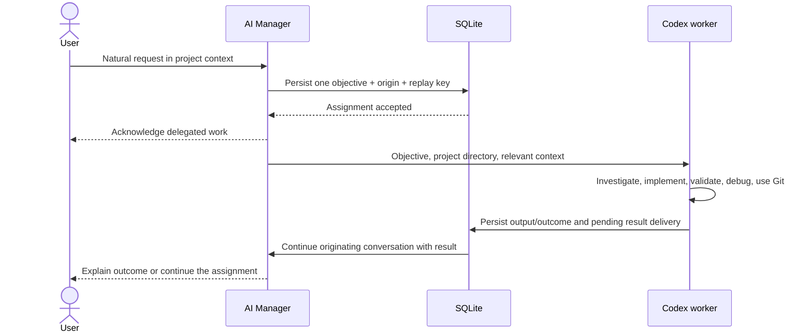

# Radical simplification plan

Date: 2026-10-11. Audited source: `f03e411748c589697dca9393e170dc59f46bdc88`.
Status: proposal only; no implementation or deployment.

## Decision

Reduce Linko to **User → AI Manager → Codex worker → AI Manager → User**. Keep FastAPI, SQLite, the existing browser interface and Codex App Server transport. Delete the machinery that plans, constrains, independently verifies, reviews and integrates an autonomous worker's assignment.

The manager understands the conversation, delegates a complete objective, receives the result and responds. Codex investigates, edits, installs dependencies, runs commands, builds, tests, debugs and uses Git through its native tools. Neither planning nor validation needs another model role. Reliability comes from durable assignments, exclusive project execution, retained execution history and resumable threads—not mandatory supervision of each action.

This proposal supersedes architectural requirements in MASTER_SPEC.md and earlier stage plans that conflict with the user's new direction. Those files are historical inputs to this audit, not reasons to retain obsolete gates. Update their current requirements during implementation; do not erase historical evidence.

## Audit scope and evidence

The audit covered all 22 Python modules, the three browser assets, SQLite schema/migrations, CLI, deployment/backup templates, all test and script surfaces, dependency manifests and repository documentation. Traced delegation, execution, completion, permissions, integration, scheduling, history, context and startup/shutdown recovery. Test names and fixtures were inspected to identify existing guarantees and migration dependencies. Earlier simplification reports, operations/security/reliability records and deployment history were compared with current source.

No live database was opened, application initialized, model assignment launched, production configuration changed, service restarted or existing task altered. Working tree was clean at entry. Installed `codex-cli 0.162.1` help and generated App Server schemas were inspected locally; schema output went to `/tmp/linko-radical-audit-schema`. This establishes protocol availability, not a passing end-to-end native-worker test. No application regression run is claimed for this documentation-only change.

Measured baseline, including comments and blank lines:

| Surface | Size |
| --- | ---: |
| Backend | 22 Python modules; 6,631 lines |
| Browser | 444 lines across HTML, JavaScript and CSS |
| Tests | 3,342 Python lines |
| Scripts | 2,765 Python lines |
| Model roles | 5 configured roles |
| Task statuses | 9 |
| SQL tables | 23 declared tables, including schema metadata |

Source is authoritative for current behavior. README.md, PROJECT.md and older operations documents contain superseded statements about disabled scheduling, required command registration and unavailable installs/merges. The latest deployment report is historical evidence, not a fresh production inventory.

### Current execution path

1. `web.create_app` constructs Chat, Workers, Planner, Verifier, Scheduler, Policies and VerificationCommands. Startup separately recovers chat, workers and role executions, discovers repositories, exports memory, discovers verification commands and starts the scheduler.
2. Auto chat runs the manager; its `manager_action(plan_goal)` invokes a separate planner model. Execute mode bypasses conversational interpretation and calls that planner directly with recent history. Conversation mode prohibits delegation.
3. `Planner.plan/apply` creates structured plans, up to 20 tasks, task-kind evidence specifications and dependency edges. Stage 2 prefers one assignment, but retains the entire DAG contract and separate planning turn. Exact unfinished repeats can bypass planning.
4. `Scheduler._tick`, `Workers.readiness/start` and `Tasks.claim` contain overlapping dispatch checks. The scheduler still supports enablement, project scope and batch completion budgets. New-database defaults are now globally enabled and continuous; previously stored restrictions survive reopening.
5. Workers use shallow standalone clones. `AppServer.safe_config/thread` disables native shell, execution, patch, web search and other tools, and starts read-only threads. The worker instead calls `manager_workspace`, which delegates to Capabilities, Policies and Workspace.
6. Each brokered operation can involve ownership checks, policy/approval state, an operation ledger, file hashes, runtime provisioning and a pre-command copy. Tests use disposable copies; dependency/network behavior differs by operation.
7. A completed worker turn enters `verifying`. Verifier leases a separate controller execution, selects/reruns checks, validates content digests and task-kind evidence, invokes an independent AI reviewer and then invokes Integrator. Integration itself has policies, evidence snapshots, executions and reconciliation.
8. Successful verification records completion/checkpoints and updates memory. Failure can become a configuration/runtime blocker, with distinct launch retry, worker resume, verification retry and integration reconciliation paths.
9. Worker results are persisted and exposed through receipts, polling and execution SSE. **No worker-completion callback resumes the originating manager conversation.** Chat stores dispatch-time task receipts; neither `Workers.finish` nor `Verifier.verify` delivers the eventual result into a manager turn. There is also no durable task-to-origin-conversation association.

The five roles are interactive, planning, execution, verification and summarization. Summarization is configured/referenced in recovery but has no active model invocation found. Do not count its removal as a runtime AI-call saving.

## Delete entirely

| Component | Concrete deletion | Why it has no place in the target |
| --- | --- | --- |
| Separate planner | `Planner`, `PLAN_SCHEMA`, plan application/reuse helpers and planning role in orchestration.py | The existing manager turn can formulate the objective; the worker can plan its own implementation. |
| Task DAGs | Dependency generation, dependency dispatch queries, task decomposition reasons and dependency editing | Internal development steps belong to one assignment. Actually separate work can be delegated sequentially after a result, without a persistent DAG engine. |
| Verification controller and AI reviewer | `Verifier`, `REVIEW_SCHEMA`, verification-controller executions, independent review invocation and `structured_turn` once unused | Codex chooses and performs validation. Manager receipt handling is not a second acceptance review. |
| Verification command machinery | verification.py, command discovery/registration/approval/revocation, config identities, selected/approved reconciliation and related API/UI | No manager-maintained language-specific command registry, including automatic registration of worker tests. |
| Verification strategies | verification_strategies.py, task kinds and mandatory evidence-file/section/allowed-path schemas | Natural-language objectives describe deliverables. The worker selects relevant evidence. |
| Verification runtime/copies | verification_runtime.py, verification_workspace.py, offline runtime packaging and `scripts/package_verification_runtime.py` | Native Codex execution uses available project tools and installs what it needs. Tests may write artifacts normally. |
| Capability broker | capabilities.py, `WORKSPACE_TOOL`, brokered read/write/test/install/commit/command handlers | Restore native Codex tools instead of recreating a coding agent inside Linko. |
| Permission framework | policies.py profiles, action categories, overrides, proposal hashes, policy epochs and general authorization polling | Routine work has one global autonomous default. Keep only the small catastrophic confirmation interaction described below. |
| Administration grant framework | administration.py, `owner-admin` CLI, grant/receipt settings and manager `owner_admin` action | Most actions administer deleted verification/policy/reconciliation systems. Ordinary authenticated project/task controls need no second grant framework. |
| Integration controller | integration.py, integration policies/results workflow and owner reconciliation endpoint | Git belongs inside the worker assignment. No separate post-review commit/merge pipeline. |
| Custom workspaces and command runner | workspace.py clone preparation, file capability wrappers, bubblewrap/systemd-run/prlimit command execution and recovery-copy creation | Default to the registered project directory and native Codex execution. No automatic per-assignment clone or clone integration obligation. |
| Generated memory projections | memory.py, mandatory five-document initialization/export/sync and progress/completion append workflows | Tasks, events and messages already persist the information. Repository docs remain native worker context; owner-authored private notes remain readable. |
| Routine scheduling controls | scope, batch budgets, enable-to-run protocol, `run_queue`, registration freeze and related dialogs | Any accepted assignment is eligible automatically, in every project. Actual pause/cancel intent remains. |
| Optional supervision presentation | daily summary generation/notifications, artificial portfolio recommendations, general approval center, verified accomplishment badges | Results arrive in chat; basic activity/history is sufficient. Catastrophic questions appear in their originating conversation. |

Delete corresponding Pydantic request models, endpoints, browser handlers, settings writers and tests that assert the removed policies. Stop writing obsolete tables/settings; preserve historical rows during migration. “Delete component” does not mean delete execution artifacts, private notes or audit history.

## Substantially simplify

| Existing source | Target responsibility |
| --- | --- |
| orchestration.py (1,194 lines) | A small always-running queue drain and direct manager actions. No planner/verifier/reviewer jobs. Retain the file if useful; do not introduce a scheduler framework. |
| workers.py (566 lines) | Claim project, start/resume native Codex, persist IDs/output/events, interrupt, record outcome and enqueue manager delivery. One lifecycle for normal work and continuation. |
| tasks.py (168 lines) | Objective, project, origin conversation/message, idempotent delegation key, status, current attempt and wait reason. Transactional claims/revisions. No verification/permission/dependency metadata for new work. |
| codex.py (247 lines) | Existing JSON-RPC transport, native thread/turn operations, account/catalog checks, notifications and user input. Distinguish read-only manager from autonomous worker at thread creation. Remove worker-native-tool suppression and blanket rejection of native requests needed for interaction. |
| chat.py (587 lines) | Natural conversation, small relevant context, direct delegation and durable worker-result continuation. Remove Execute/Conversation/Auto modes, administration grants and receipt/audit boilerplate. Keep archives/search and thread resume. |
| web.py (807 lines) and static/ | Authenticated chat/projects, activity/history, basic stop/continue/cancel, two model routes and instructions. Remove all deleted API/settings surfaces and misleading gate copy together. |
| registry.py (224 lines) | Stable identity/path/display name, automatic discovery, project instructions/objective and active/paused/archive state. No per-project scheduler/permission/runtime configuration. Preserve owner notes without mandatory projections. |
| db.py (220 lines) | Keep transactions, migration, events and backup/restore. Add only fields/indexes needed for origin, exclusive claims and result delivery; make historical supervision records inert. |
| cli.py and scripts/ | Keep setup, serve, discovery, backup/restore, session revocation and one representative native-worker/browser smoke path. Remove duplicate stage-specific harnesses after equivalent essential coverage exists. |

One manager delegation action needs project ID (or selected project), objective and optional existing assignment ID. Use the existing tool-call ID plus originating manager execution as the durable replay key. No task array, evidence schema, permission list or extra intent classifier. Retain small project status/read actions only where they avoid unnecessary coding assignments.

A manager may request a selected-project document through a small read action. Keep path/size validation at that HTTP/tool boundary; do not retain the full Workspace abstraction to implement it.

## Must remain

- **FastAPI and plain browser assets:** streaming conversation, project selection, saved history and visible errors. No UI rewrite or new frontend framework.
- **SQLite WAL/FULL transactions:** durable conversations, messages, assignments, attempts, events, settings and user questions. Preserve stable IDs, optimistic revisions and backup/restore integrity checks.
- **Authentication:** Argon2, one-time setup, revocable secure sessions, CSRF/origin/host checks, throttling and CSP. These protect a coding service from unauthorized users; they are not agent supervision.
- **Codex App Server transport:** installed ChatGPT authentication, native persistent thread IDs, model catalog validation, usage and owned-process cleanup. Keep the existing provider/billing behavior.
- **Project registry:** automatic discovery plus explicit directory registration, default project root, display names and instructions. Project roots are a global discovery setting, not per-project scheduling setup.
- **Exclusive execution:** the single-manager data-directory lock and atomic project claim. Different projects run concurrently; exactly one coding worker owns a project's directory, including continuations. Keep one global capacity limit (current default two), with no scope/batch setup.
- **Execution history and ownership:** persist task/attempt/thread/turn IDs before relying on them, stream native activity, retain errors and PID/start identity when process ownership matters. Signal only owned processes. A lease expiry alone does not prove a worker stopped.
- **Restart recovery inside the ordinary lifecycle:** inspect retained thread/turn state, resume the same assignment and deliver pending results. Keep project exclusivity until any surviving worker is accounted for.
- **Basic resource hygiene:** bounded stored output, storage reporting and a minimal launch/storage guard. Native timeouts/process cleanup replace bespoke per-command cgroups. Do not add automatic pruning or a quota framework.
- **Existing service/backup infrastructure:** private hosting and restart policy, daily database backups, manual restore to a fresh path. Preserve separate Codex thread storage; database backup alone cannot restore native execution history.
- **Catastrophic confirmation:** exact, visible, durable questions for truly broad destructive actions. No routine approval profile.

Manager and worker model settings remain global, validated against the installed catalog. Reduce five roles to two; keep native compaction. Native tools/skills can be used by Codex without manager-created tool inventories or registered command catalogs. Do not add multi-agent coordination inside Linko.

## Minimal execution flow

1. Persist the user message and run the ordinary manager turn. Discussion remains discussion; a request to do work permits delegation without another launch approval. Resolve contextual references such as “do it” in this same turn. Select the intended project; ask only when necessary information is missing.
2. The delegation tool atomically stores one objective and its origin, or references an existing assignment. Record relevant constraints/acceptance in natural language. Never require the user to author tests or choose a task kind. Replay of the same delegation returns the same assignment; semantic reuse is manager judgment, not another AI call or global text deduplication heuristic.
3. The existing queue drain claims an eligible assignment whenever its project is free and global capacity permits. Every active registered project participates automatically. Multiple requests for one project queue; distinct projects can run concurrently. Persist the claim/attempt before launch.
4. Start a persistent Codex thread with `cwd` equal to the registered project directory and native execution enabled. Supply the objective, project/global instructions and only relevant conversational decisions or owner notes. Let Codex read repository instructions and files itself. Existing projects with dirty working directories or no initial commit are not blocked merely by the manager's old clone requirements.
5. Codex completes investigation, edits, dependency installation, builds, testing, debugging and requested Git operations in its assignment. Validation is its decision. No mandatory second test run or reviewer. Local changes are immediately in the project; use a branch/worktree when Codex finds it useful, without a manager clone/integration pipeline. Preserve existing user edits. Pushing or deployment follows the assignment's actual scope, without standing per-project permission configuration.
6. Persist native final output, errors and execution references. A protocol `turn/completed` means a turn ended; it does not prove an objective succeeded. Preserve reported partial results/uncertainty and failures. “Completed” means reported fulfillment, not independently certified acceptance. The returning manager turn can continue incomplete work on the same assignment, without an acceptance controller or required verdict schema.
7. In the same transaction as recording a result, record pending delivery and its original conversation ID. Drain deliveries through Chat when that conversation has no active manager turn. Supply the result to the existing manager thread as worker output, with the assignment ID and objective. The manager responds or delegates continuation. No summarizer, classifier or reviewer is inserted.
8. Persist delivery identity/manager execution association so reopening the service recovers pending results. A browser disconnect or switch to another project does not cancel work or reroute results. If the origin was archived/reset, record delivery in the archived origin and notify the active conversation in that same project context; do not silently inject it into whichever project is open.

Result delivery requires only task/attempt origin and delivery fields plus an indexed scan of unfinished deliveries, not a message bus, outbox service or new workflow abstraction. Serialize manager turns per conversation. If several project workers return to one global conversation, deliver them in order or together in its next turn. User messages and results must not race on the same thread.

Exactly-once database association is feasible. Exactly-once model execution across a crash is not promised: record delivery intent before `turn/start`, retain turn identity, and inspect native history for a persisted result before submitting again. Test the gap where Codex accepted a turn but the service did not persist its ID. Do not silently replay delegation or external side effects during recovery.

### Six task statuses, not a supervision state machine

| Status | Meaning |
| --- | --- |
| queued | Accepted, waiting for project/global capacity |
| running | Assigned to the live worker lifecycle |
| waiting | Paused by user, needs information/confirmation, or cannot currently proceed; reason stored as data |
| completed | Worker reports objective fulfilled; result retained |
| failed | Assignment/launch stopped unsuccessfully; partial output retained |
| cancelled | User explicitly stopped the assignment permanently |

Normal path is queued → running → completed. Interruption or a genuine blocker uses waiting; continuing returns through the same queue/worker lifecycle. Failed work can continue on its existing task with a new attempt. Terminal history is never erased. Do not create statuses for planning, testing, review, provisioning, integration, recovery or result delivery. A completed task awaiting manager delivery does not reserve a coding slot; an uncertain surviving worker does.

### Restart behavior

Use one startup pass over unfinished attempts and pending deliveries. Inspect saved native threads/turns and process ownership. If a persisted terminal output exists, record/deliver it without rerunning work. If the prior worker is gone and the assignment remains authorized, resume its existing thread with the interruption context; Codex inspects current files/Git and continues. A launch that demonstrably never reached a worker turn can restart the same assignment normally. Preserve deliberate user pauses and cancellations.

An observed detached process or unresolved launch identity keeps that project unavailable until accounted for; do not release its slot and launch a duplicate. Where safe continuation cannot be established automatically, retain waiting with the concrete reason. Asking for missing information is allowed; routine “owner reconciliation approval” is not a prerequisite. No separate recovery task, retry controller, command ledger replay or infinite blind retry loop.

### Native autonomy and the remaining confirmation boundary

The installed schema supports persistent thread start/resume/read, native sandbox modes, user approval requests and `item/tool/requestUserInput`. `approvalsReviewer=auto_review` explicitly invokes a review subagent; **do not enable it** as a substitute for the deleted verifier.

Recommended worker baseline is native `danger-full-access`, `approvalPolicy=on-request`, with user-routed interaction and the native shell/patch/exec tools enabled. This is a trusted single-owner coding agent, not a security boundary between mutually untrusted tenants. It provides the broad permissions requested without manager-maintained per-project profiles or escalation prompts for routine filesystem/command work. Keep the manager itself read-only with only its small orchestration tools.

Use one short worker instruction: complete the objective autonomously, preserve user work, validate as appropriate, and ask before genuinely catastrophic broad destruction. Examples: wiping a project/volume, dropping a production database, mass deleting shared data or destroying infrastructure. Ordinary file deletion, dependency installation, tests, branch creation and commits do not merit confirmation. A request to do ordinary work does not authorize unrelated destructive scope.

Bridge native user input into the originating chat. Retain exact action/target/consequences, task/attempt/question identity and explicit answer in SQLite; absence of an answer never grants permission. On restart, invalidate an unconsumed question if its target/action changed and reissue it through the resumed worker. There is no general policy epoch, category matrix or reusable permission grant.

**Limit:** native full access plus on-request approval does not intercept every command. The schema is not evidence of universal catastrophic-action detection. Confirmation depends on Codex recognizing and requesting it; arbitrary shell/program effects cannot be reliably classified by the existing regex either. The proposed boundary is conversational confirmation, with durable routing—not a deterministic prevention guarantee. If deterministic containment is later required, it is a distinct operating-boundary requirement and must be weighed against the desired autonomy; do not conceal a new command broker in this simplification.

## Functionality and guarantees lost

| Removed behavior | Consequence/tradeoff |
| --- | --- |
| Independent test reruns, content hashing and AI review | Completion is worker-reported. Validation may be inadequate; manager reports evidence and limits without certifying it independently. |
| Brokered per-operation enforcement and no-host-home sandbox | Native workers gain same-user host visibility/access, including potential manager-state and credential access. Read-only manager settings do not isolate it from a malicious full-access worker. Keep authentication and private storage, but do not describe them as protecting against that worker. |
| Source-preserving clones and controlled ff-only integration | Source directories change during work. Existing edits must be preserved by Codex; conflicts and Git strategy are handled inside the assignment. No source-unchanged guarantee. |
| Per-command preimage/copy and operation ledger | No manager-provided restoration of every command input, stale-write prevention or deduplication of arbitrary external side effects. Retain Git/files/history and native thread context, not equivalent transactional semantics. |
| Immutable independent acceptance snapshots/verified badges | New work cannot claim the old verification guarantee. Historical independent evidence remains readable with its original labels. |
| Plans/DAGs and completion budgets | No persistent dependency planner, cross-task stage enforcement or “stop after N completions” scheduler. Real sequential dependencies use manager continuation; independent objectives queue normally. |
| Scoped profiles and configuration grants | No per-project permission overrides, verification-command approvals or administration grant ledger for future work. |
| Bespoke command resource sandbox | Per-command 2GB/CPU/process/output-growth enforcement is removed. Global worker capacity/output/storage checks are not equivalent quotas. |
| Mandatory private Markdown projections and daily notifications | No automatically synchronized five-document handoff or daily summary. Owner notes, task/history views and automatic conversational results remain. |
| Hard-coded sensitive-capability exclusions | Native workers can use tools accessible to the service account. Assignment scope and catastrophic questions govern intent; remote access still depends on actual credentials/network availability. |

These are deliberate tradeoffs, not missing implementation work to recreate under different names. Native execution/runtime compatibility, restart recovery and human-input routing still need real tests before deployment.

## Estimated reduction

Ten modules proposed for complete deletion total **2,404 backend lines**: capabilities (276), policies (372), administration (193), verification (554), verification_runtime (76), verification_strategies (123), verification_workspace (83), integration (325), workspace (334) and memory (68). A few essential helpers move into existing files; this is gross deletion, not net savings.

Removing Planner/Verifier/structured_turn and shrinking Scheduler deletes most of another 1,194-line module. Workers, chat, web and registry also lose related paths. Allowing for native event handling, delivery and migration, estimate **3,000–4,000 net backend lines removed (45–60%)**, leaving roughly **2,600–3,600 lines**. This is a design estimate, not a measured future diff. Backend modules can fall from 22 to about 12, without replacing them with new classes/frameworks.

| Measure | Current | Target |
| --- | --- | --- |
| Model roles | 5 | 2: manager and worker |
| Auto delegated objective, successful ordinary case | Manager delegation + planner + worker + independent review; no automatic final manager return | Manager delegation + worker + manager result turn |
| Execute shortcut | Planner + worker + independent review; no conversational interpretation/automatic final manager return | Same natural conversational path as above |
| Separate planning/review model invocations | Usually 2 per new successful objective | 0 |
| Net ordinary Auto model turns | Usually 4 | Usually 3; 25% fewer while adding the missing return path |
| Task statuses | 9 | 6; 33% fewer |
| Custom worker tool definitions | manager_workspace | 0; native Codex tools |
| Supervision runtime modules | 10 deletable modules plus large planner/verifier sections | None |
| Active schema | 23 declared tables | Approximately 12–14 useful tables after later historical cleanup |

“Calls” here means top-level model role turns, not internal inference requests/tool steps. A capable worker may take many native steps. Repeated goals, failures, requests for information or additional user instructions change totals. Execute already avoids a manager interpretation turn, so its present three turns versus the proposed three are not a net call saving. Do not claim five calls or automatic summarizer usage today.

Tests/scripts can lose hundreds to thousands of lines tied to removed machinery, but exact net savings depend on replacement persistence/native-flow coverage. Do not use a deletion target to justify removing essential regression coverage. Historical tables remain in the first release; table-count savings describe future active schema, not immediate data deletion.

## Coupled changes and migration risks

| Safe implementation group | Dependency and risk |
| --- | --- |
| Direct delegation + plain objectives + task completion simplification + removal of planner/verifier | Change together. Deleting planning alone leaves mandatory kind/evidence metadata undefined; deleting review alone leaves tasks stranded in verifying. This was the reason Stage 2 retained planning, and this proposal removes its downstream requirement. |
| Native worker + broker/policy/runner/runtime deletion + worker-owned Git | Change together. Turning native tools on while retaining controlled-operation assumptions creates two contradictory execution models. Keeping Integrator leaves a verified-evidence dependency and stale workspace paths. |
| Always-on queue + exclusive project claim + simplified task states/recovery | Change together. Removing scope checks without preserving deliberate pauses could execute old work unexpectedly. Releasing claims on uncertain process loss can duplicate writers. |
| Origin association + transactional result/delivery recording + conversation serialization | Add with the minimal flow, not as a later optional feature. A callback alone loses results on restart and can race user turns. |
| API/schema cleanup + browser cleanup + CLI cleanup | Ship together so removed endpoints are not referenced by buttons, settings or tools. Native activity replaces verification-controller monitor entries. |
| Documentation/test revision + backup/rollback preparation | Replace assertions for deleted behavior with assertions for retained guarantees; revise current requirements and capability claims before deployment. |

Do not migrate the live application in this audit. During later implementation:

- Build and test in an isolated checkout/data directory; do not initialize the production database to inspect it. Use a copied database for migration rehearsals.
- Prefer additive assignment/delivery fields and indexes first. Old SQLite task status CHECK constraints require a transactional table rebuild if statuses are physically renamed. Preserve every ID/reference and all history; test foreign keys and row counts. An initial legacy-read adapter can display new statuses without destructive row rewrites, but must not become a permanent dual scheduler.
- Preserve plans, dependencies, verification/integration results, approvals, operations and private memory as historical records. Remove their active readers/writers and expose relevant historical evidence through generic history. Do not pretend previously verifying work was independently accepted by converting it to completed.
- Do not automatically enqueue legacy unfinished tasks when removing gates. Old pending tasks may rely on removed dependencies; old clones may contain unmerged edits; old operation-ledger rows may describe uncertain effects. Mark legacy unfinished work as waiting for continuation, retaining original status/reason in history. Let a later manager/user continuation reuse the same task and native worker inspect the stored clone/source. No silent migration-time replay, merge or completion. This one-time compatibility treatment is not new-project scheduling configuration.
- Preserve deliberate project/task pauses, cancellations, archive/remove states and existing authentication. Record removal of obsolete global scheduler restrictions explicitly at the eventual cutover, rather than assuming an old disabled scheduler authorized all historical tasks to run.
- Resume old worker threads only if native tool configuration is compatible. The current manager already rolls over tool-schema changes. Old dynamic-tool worker threads may need a new native thread on the same task with saved output/path references; test this, retain old thread IDs and never recreate the objective as a replacement task.
- Retain historical clone/runtime/recovery artifacts until disposition is known. Stop creating new ones; do not include bulk cleanup in the behavioral cutover.
- The service runs directly from this repository. Do not edit production-imported code for a half-migrated release. Prepare a complete reviewable release before any later authorized deployment.

Rollback needs the old code plus the pre-cutover database and native thread/project-file context. Restoring SQLite alone cannot undo worker edits, commits or external effects. Stop new execution before rollback; do not run both schedulers against the same projects. Deployment/restart and production task migration remain outside this task's authorization.

## Short ordered implementation plan

1. **Prepare compatibility and baseline fixtures.** Freeze the current reference architecture in documentation, copy a database for migration tests, inventory legacy task/artifact links, and preserve auth/history/backup tests. No production mutation.
2. **Implement the minimal flow in existing files as one coupled change.** Direct manager delegation; six statuses; always-on atomic project claims; native autonomous workers; worker-owned validation/Git; task origin and durable manager return. Delete planner, verifier, reviewer, broker, policies, integration and custom runner code as their callers disappear.
3. **Consolidate restart and confirmation handling.** Ordinary same-task continuation uses native persisted threads; serialize conversation result turns; recover pending deliveries; bridge catastrophic native questions with explicit durable answers. Remove specialized retry/reconciliation workflows.
4. **Remove obsolete product surfaces and projections.** Delete API/UI/CLI settings, task-kind forms, chat modes, command registries, grant controls, verification badges and auto-generated memory workflows. Keep historical records and owner-authored notes readable. Reduce model routing to two roles.
5. **Validate the retained guarantees and migration.** Test natural delegation/contextual follow-up, one ordinary assignment, discussion without launch, two projects concurrently/one worker per project, routine edits/install/build/test/Git without approval, catastrophic question before action, interrupt/continue, no blind duplicate launches, persisted results delivered after crashes/browser disconnects, auth/history/archive/reset and backup restoration. Include crash windows around claim, thread/turn start, worker finish and manager delivery. Run one real disposable native Codex end-to-end assignment and relevant browser/regression checks; test dirty/nonstandard/new project directories.
6. **Prepare a complete release and review cutover evidence.** Update current README/spec/operations/security claims, rehearse migration against the copy, quantify actual deletions and inspect preserved records. Only subsequently deploy/restart under separate authorization, with legacy work kept inert until continued. No speculative new policies, frameworks, reviewer agents or task hierarchies.

The acceptance criterion is a complete objective handled by native Codex and returned automatically to its manager conversation, across project concurrency and service restarts, with no project-specific scheduling/permission/verification setup and no routine supervision gate.
